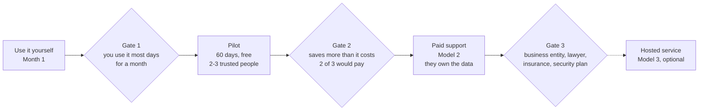

# Personal Agent Business Plan

Oct 20, 2026 · @Russ Broomell

## Summary

Offer a friendly personal assistant, built on the open-source Hermes Agent, that people text like a capable helper. It saves them time and money, and what it learns stays under their control. Grow in four gates: use it yourself, give it to two or three trusted people, sell setup and support while each person owns their own server and accounts, and only later consider a hosted subscription.

One rule runs through the plan: **don't hold anyone else's financial data until the business is built to protect it.** Until then, each person keeps their own server, AI account and bank connection, and you sell the setup, updates and support.

This is a planning document, not legal advice. A lawyer should review the terms before the first invoice.

## Why people would pay

The pitch is concrete: by day 30, its savings ledger shows it saved more time and money than it costs. That's the case to make, because big-company agents win people on day one and lose them in week two (Muse brings back 73% of new users the next day but drops fast after a week, per [Yahoo Finance](https://finance.yahoo.com/technology/article/metas-muse-ai-agent-brings-back-73-of-new-users--nearly-double-chatgpts-rate-164557360.html)).

- **Time:** booking and rescheduling, forms, look-ups, inbox cleanup, follow-ups on things people forget.
- **Money:** a subscription audit with cancellations, calls to lower bills, return and warranty windows, avoided late fees and auto-renewals.
- **Privacy:** memory lives on the person's own server. The alternatives keep it themselves: Meta can technically reach Muse's machine and admits it's open to prompt injection; Instinct claims a perpetual license to user material for training.

| Competitor | Price | Data stance |
| --- | --- | --- |
| [Meta Muse](https://www.techrepublic.com/article/news-meta-muse-ai-agent-us-launch/) | Free; $20 and $100/month | Runs on Meta's cloud; encrypted version still promised |
| [Instinct](https://www.vellum.ai/md/blog/official-instinct-breakdown) | Not published (invite-only) | Perpetual license to user material for training |
| [Grok Bot](https://venturebeat.com/orchestration/spacexais-grok-bot-turns-agents-into-persistent-digital-coworkers-that-can-operate-your-apps-for-120-per-month) | About $200/month, bundled | No model choice; credential handling not disclosed |
| This offer | Set after the pilot | The person's own server and accounts |

The first customers are likely people who share needs and rhythms, such as people in the same line of work, which keeps onboarding and support simpler.

## Three offering models

Start with model 2. It earns money without making you the keeper of anyone's financial data.

| Model | Who holds the data | What you do | Revenue | Burden |
| --- | --- | --- | --- | --- |
| 1. Free kit | Each person, on their own server | Share the setup as a Hermes [profile distribution](https://hermes-agent.nousresearch.com/docs/user-guide/profile-distributions): personality, skills, scheduled jobs, installed with one command | None | Low |
| 2. Setup and support subscription | Each person: their own server, AI account and Plaid Trial | Install it, run onboarding, keep skills and rules updated, help when stuck; admin access only while helping | Setup fee plus monthly support | Medium |
| 3. Hosted subscription | You, on your servers or Nous's [Hermes Business](https://portal.nousresearch.com/business) | Run every customer's agent, pay for their AI and bank-data use, bill monthly | Monthly subscription | High: effectively a fintech startup |

## Path to market

Each gate must be passed before moving right. Paid support (model 2) is the target; hosting (model 3) is optional and only worth it if demand justifies running a regulated business.

## What changes when it's offered to others

Most of these obligations land only in model 3. Model 2 avoids the heaviest ones by leaving data and accounts with each customer.

| Area | Model 2 (they own it) | Model 3 (you host it) |
| --- | --- | --- |
| Software license | Hermes is [MIT-licensed](https://github.com/NousResearch/hermes-agent/blob/main/LICENSE): selling and modifying are allowed if the copyright notice stays. Give the product its own name | Same |
| AI model | Each person's own AI account | You pay and mark up; check the provider's commercial terms and rules for consumer-facing apps |
| Bank data | Each person signs up for their own free Plaid Trial (10 bank logins) | Your paid Plaid Production account: company profile, security questionnaire, privacy notice and consent for every user; prices shown only during the application; Transactions bills monthly per connected login ([checklist](https://plaid.com/docs/launch-checklist/)) |
| Financial-data law | Mostly theirs; you touch data only while helping | Likely covered by the federal [Safeguards Rule](https://www.ftc.gov/legal-library/browse/rules/safeguards-rule): written security program, risk assessments, breach reporting. Confirm with a lawyer |
| Bank-data costs | Free on their Trial | May rise: the CFPB open-banking rule is [blocked and being rewritten](https://www.openbankingtracker.com/guides/section-1033-status), and banks are starting to charge aggregators |
| Phone calls | Off by default; opt-in per person | The FCC treats AI voices as "artificial voices" under the TCPA; calls placed for a customer to a business aren't settled, and states differ ([eConsent](https://econsent.org/posts/ai-voice-agents-tcpa-rules-october-2026/)). Legal review before selling |
| Acting for people | Terms of service that limit liability; the approval log records who said yes | Same, plus insurance |
| Privacy | A short privacy policy covering support access | Full privacy policy, deletion on request, breach response plan |
| Support | Business-hours help | Someone answers when it breaks at 7am on a Sunday |

## Costs and pricing approach

Set the price after the pilot measures real costs. Support time will likely be the largest of them.

| Cost per person, per month | Model 2 | Model 3 |
| --- | --- | --- |
| Server | Theirs | Yours |
| AI usage (varies most) | Theirs, with a spend cap | Yours; set per-person caps |
| Bank data (Plaid) | Free on their Trial | Monthly fee per connected login |
| Phone minutes | Theirs, if calls are on | Yours, if calls are on |
| Your support time | Yours | Yours, more of it |

Pricing principles:

- **Model 2:** a one-time setup fee that covers installation and onboarding, plus a monthly fee for updates, new skills and support. Their running costs are paid directly by them, so your price is only your time.
- **Anchor on savings, not features.** The savings ledger is the sales pitch. If the median pilot user saves several times the monthly fee, the price is defensible.
- **Keep it below the big-company ceiling.** Muse tops out at $100 a month and Grok Bot is about $200; a support fee plus running costs should land well under those.

## Pilot plan and success measures

Run a 60-day pilot with two or three trusted people, each on their own server and accounts, before charging anyone.

**Setup:** a demo bot on Hermes Cloud with sample data shows what it does; each pilot user then gets their own install, the 20-minute onboarding interview and a first win on day one.

| Measure | How it's tracked | Target to move on |
| --- | --- | --- |
| Weekly use | Days per week each person texts it, in weeks 2 to 8 | 5 of 7 days |
| Value | Savings ledger: hours and dollars saved, net of running costs | Saves more than it costs by day 30 |
| Running cost | AI usage, server, phone minutes per person | Known within 20% |
| Support load | Your hours per person per month, from a simple log | Fits the price you'd charge |
| Trust | Approvals requested versus surprises reported | Zero actions taken without approval |
| Willingness to pay | Asked at day 60: "Would you pay $X a month to keep this?" | At least 2 of 3 say yes |

Keep a shared friction log: every confusing step and every fix by hand becomes a product improvement.

## Risks and mitigations

| Risk | What could happen | Mitigation |
| --- | --- | --- |
| Agent acts wrongly | Sends, buys or cancels something the person didn't want | Approval gate on every irreversible action; "always allow" never offered for money or speaking for them; approval log |
| Prompt injection | A web page or email tricks the agent | Outside text is data, never orders; sandboxed browser; low-privilege accounts |
| Data breach | A customer's server or your support access is compromised | Each person's data on their own server; support access only while helping; encrypted backups |
| Support overload | Setup and fixes take more time than the fee covers | Narrow first audience; a standard install; the pilot's support log sets the price |
| Bank connections break | Banks require re-sign-in or block aggregators | Plaid for most banks; CSV or SimpleFIN fallback; costs reviewed if banks start charging |
| Rules change | Financial-data or AI-calling rules tighten | Stay in model 2 until rules settle; calls opt-in; legal review before each new offering |
| Platform dependency | Hermes, Nous or the AI provider changes terms or prices | MIT license lets you fork; model-agnostic setup lets you switch providers |
| Competitors | Muse or Instinct get cheaper or better | Compete on privacy, a human who helps, and a proven savings ledger, not features |

## Next steps

- [ ] Build your own agent and use it for a month (the build instructions come next)
- [ ] Set up the Hermes Cloud demo bot with sample data
- [ ] Pick two or three pilot users and start the 60-day pilot
- [ ] Choose a product name
- [ ] Draft terms of service and a privacy policy, and book a lawyer's review
- [ ] At day 60: decide price, and whether to open model 2

Sources: [Personal Agent Plan](plan.md) · [Hermes license](https://github.com/NousResearch/hermes-agent/blob/main/LICENSE) · [Hermes profile distributions](https://hermes-agent.nousresearch.com/docs/user-guide/profile-distributions) · [Hermes Business](https://portal.nousresearch.com/business) · [Plaid launch checklist](https://plaid.com/docs/launch-checklist/) · [Plaid Trial plan](https://support.plaid.com/hc/en-us/articles/39994173227159-What-is-the-Plaid-Trial-plan) · [FTC Safeguards Rule](https://www.ftc.gov/legal-library/browse/rules/safeguards-rule) · [Open Banking Tracker, Section 1033](https://www.openbankingtracker.com/guides/section-1033-status) · [eConsent, AI voice calls](https://econsent.org/posts/ai-voice-agents-tcpa-rules-october-2026/) · [TechRepublic, Muse](https://www.techrepublic.com/article/news-meta-muse-ai-agent-us-launch/) · [Vellum, Instinct](https://www.vellum.ai/md/blog/official-instinct-breakdown) · [VentureBeat, Grok Bot](https://venturebeat.com/orchestration/spacexais-grok-bot-turns-agents-into-persistent-digital-coworkers-that-can-operate-your-apps-for-120-per-month) · [Yahoo Finance, Muse retention](https://finance.yahoo.com/technology/article/metas-muse-ai-agent-brings-back-73-of-new-users--nearly-double-chatgpts-rate-164557360.html)
