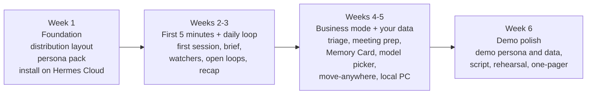

# MVP Plan: A Personal Agent You Own

Nov 3, 2026 · @Russ Broomell

## Summary

Turn the current starter kit, which is one person's hand-configured Hermes agent, into a product someone else can install in under 10 minutes, enjoy in the first 5, and still use every day in week three. The MVP is what we demo to potential customers. It isn't the full feature set from `plan.md`.

**The pitch in one line:** a personal agent with a real personality that does the useful things Muse, dots and Poke do. It runs where you choose (Hermes Cloud, your VPS or your own PC) on the model you choose (local, or a cloud provider you pick), and you can read, edit and move everything it knows about you.

**What we build:** a Hermes [profile distribution](https://hermes-agent.nousresearch.com/docs/user-guide/profile-distributions) containing:

- a personality pack
- a 5-minute first session
- a daily loop (morning brief, watchers, open loops, evening wrap, Friday recap)
- a light business mode
- "your data" features that show the ownership story in a demo
- a one-command install for all three hosts

**What we skip for the MVP:** Plaid, phone calls, virtual cards, group chats and multiple bots. They stay in `plan.md` for later. Each adds legal, cost or security weight that a demo doesn't need.

**Target:** demo-ready in about 6 weeks of evenings, with three deployments proven: Hermes Cloud, a $6–15/month VPS and a local PC running a local model.

## Build status (Nov 3, evening)

First build is in the repo, aimed at a demo on a 4 GB OVH VPS. See [setup-guide-ovh.md](setup-guide-ovh.md) and [demo-script.md](../demo/demo-script.md).

| Pillar | Status |
| --- | --- |
| Personality pack | Done: six personas (Sam, Pip, Mortimer, Rex, Nova, Vic) over shared house rules; personality strength 1-5 chosen in the first session; per-persona voices; switch by chat or script |
| 5-minute first session | Done: skill with buttons, brief scheduling, first win; follow-ups skill for the rest |
| Daily loop | Done as skills: morning brief, open loops, watchers, evening wrap, Friday recap, savings ledger, weekly distill (quiet jobs reply `[SILENT]`) |
| Business mode | Done as skills: inbox triage (forwarded mail or a connected mailbox), meeting prep |
| Your data | Memory Card page (tested locally); model choice (docs/models.md); move, backup and update scripts |
| Browser you can take over | Bot Screen on the VPS, viewed in the browser workspace over Tailscale (laptop or phone, private HTTPS, password) or an SSH tunnel |
| Not yet | Private-topic routing; one-tap approvals for shell commands (Telegram buttons exist for questions only); contact card and avatar; landing page |

Change from the plan: we're running the bot's browser on our own VPS rather than Hermes Cloud. Hermes Cloud doesn't ship the desktop image Bot Screen needs yet.

## What the market looks like now (Nov 2026)

Every big lab now ships a persistent personal agent. They're converging on the same feature list, and they share the same weakness: the company holds your memory and you can barely see it.

| Product | What it does well | What we learn | Where it's weak (our opening) |
| --- | --- | --- | --- |
| [OpenAI dots](https://www.eesel.ai/blog/openai-dots) (Sep 29) | Always-on, goal-driven agent; works in the background after you leave; read-only "idle research" across connected apps; cute blob avatar | Background work with a visible "here's what I did" report; a character people recognize | Reviewers say you [can't view, edit or delete individual memories](https://www.eesel.ai/blog/openai-dots); you can only delete the whole dot. Pro/Business plans only |
| [Meta Muse](https://www.techrepublic.com/article/news-meta-muse-ai-agent-us-launch/) (Sep 8) | No. 1 free app in the US App Store; WhatsApp front door; email, travel, forms, Stripe purchases; [Gmail and Calendar](https://note.com/masahiko_studio/n/n37b4960e0104?hl=en) | Meet people in a messaging app they already use; checkout with protections | Runs on Meta's machine; Meta admits prompt-injection risk; [73% day-1 return but fast drop after week one](https://finance.yahoo.com/technology/article/metas-muse-ai-agent-brings-back-73-of-new-users--nearly-double-chatgpts-rate-164557360.html) |
| [Poke](https://blog.saner.ai/poke-reviews/) | Signup is a phone number. It lives in iMessage/SMS/WhatsApp/Telegram, gives itself a contact card, and is sarcastic from the first message. Morning overview, flight changes, "thread you're watching moved" pings | Personality and the texting feel sell it more than raw capability. Reviewers [rate the interaction model above the assistant's quality](https://blog.saner.ai/poke-reviews/) | Gimmicks (an AI "bouncer" negotiating price) drive some people away; inbox judgment still weak |
| [Instinct](https://www.vellum.ai/md/blog/official-instinct-breakdown) | Text-first errands; concierge phone calls; [group chats with non-users](https://aiweekly.co/alerts/instinct-opens-its-ai-agent-to-group-chats-with-non-users) | Do real errands end to end | Perpetual license to your material; [users want separate threads](https://www.eesel.ai/fr/blog/instinct-ai-avis) instead of one noisy one |
| [Gemini Daily Brief + Spark](https://thenextweb.com/news/google-gemini-app-daily-brief-redesign-io-2026) | Overnight digest of inbox, calendar and tasks with suggested next steps; now [free for US users](https://runtimewire.com/article/google-gemini-daily-brief-free-us-users) | The morning brief is table stakes, and it has to suggest next steps rather than just list things | Google account lock-in; no Workspace support |

Three takeaways for the MVP:

1. **Personality and texting feel are features, not polish.** Poke's growth shows it. Our current `SOUL.md` ("calm, a little dry, never gushing, no emoji") is a fine default, but it isn't *fun*. We need a personality people talk about.
2. **The daily loop is what keeps people.** That means a brief with next steps, watchers that ping only when something moves, and a visible report of what got done. Muse's week-two drop is the warning.
3. **"You own it" has to be visible, not just claimed.** Our demo moment: open a page showing everything the agent knows, edit a line, then move the whole agent from Hermes Cloud to a laptop while it keeps its memory. None of the big agents can do that.

## Where Hermes is now (v0.22.6, Nov 2)

Most of what we need is already in Hermes. That keeps the MVP mostly configuration, skills and packaging, with little new code ([releases](https://github.com/NousResearch/hermes-agent/releases)).

| Hermes capability | How the MVP uses it |
| --- | --- |
| Profile distributions (`hermes profile install`) | Our whole product ships as one: persona, skills, cron jobs (installed paused), config |
| First-launch setup chat on a free trial model (v0.22.0) | People can try the personality before entering any API key |
| One-click local models via llama.cpp, picked to fit the hardware (v0.22.0) | The "local PC, fully private" option |
| Web app served from the gateway (v0.22.6) | Our "Memory Card" and activity pages, without building a separate web stack |
| Telegram video notes and voice; ElevenLabs voice choice in TTS (v0.22.6); live transcription (v0.21.6) | Voice notes both ways; each persona gets its own voice |
| Per-skill locks and `pre_llm_call` hook (v0.22.6) | Lock our core skills against self-edits; a hook for privacy routing |
| Password-manager sign-in; confirm card/address fills (v0.22.0) | Later errands; not needed for the demo |
| `/branch` side threads on Telegram | Answers Instinct's "one noisy thread" complaint: each big errand gets its own thread |
| Memory provider plugins (Honcho, Mem0) | Not for the MVP. Plain files are the ownership story |
| [Hostinger](https://hostinger.com/vps/docker/hermes-agent) and Bluehost one-click Hermes VPS templates | The VPS install path for non-technical buyers; our installer adds our profile on top |

**Hermes's weak spot is first impressions.** Reviews call the experience [janky, with a slow start and a CLI that gets in the way](https://www.eesel.ai/blog/hermes-agent-review). Our product's job is to hide all of that.

## Who the demo is for

Pick one first audience and design the demo for them. Recommendation: **busy independents**, meaning solo professionals, small-business owners and community leaders. They have personal and work errands mixed together, care about privacy, and feel the admin load every day. Start the pilot with people from your own network who fit that description, as `business-plan.md` suggests. The demo shows one "life" persona and one "work" persona so it lands with both.

## MVP feature set

Six pillars. Everything in this table is in the MVP. Items in the "Later" section are not.

### 1. A personality people want to talk to

| Feature | What it is | Build |
| --- | --- | --- |
| **Persona pack** | Four full characters, each a complete `SOUL.md` voice section over shared house rules: **Sam** (calm, dry chief of staff, today's default), **Pip** (upbeat, a bit nerdy, celebrates small wins, light emoji), **Mortimer** (theatrical butler, deadpan, very British), **Rex** (blunt coach who calls you out on procrastination). Each has a sample texting style, a sign-off habit and a pet phrase | `distribution/personas/*.md` + `distribution/house-rules.md`; installer stitches them into `SOUL.md`. Not `/personality` overlays, which can override the house rules |
| **Name it yourself** | In the first minute it asks what to call it and offers the persona choice with one sample line each | First-session skill |
| **Strength dial** | Chosen in the first session (a hint, balanced, full character); "tone it down" or "turn it up" adjusts a 1–5 setting saved in USER.md; each persona shows the same reply at levels 1, 3 and 5 | One line in each persona + a style memory rule |
| **Contact card and avatar** | It sends its own vCard and avatar so it shows up as a person in your phone (Poke's trick) | Asset per persona; Telegram bot picture set by installer |
| **Its own voice** | Each persona maps to a TTS voice (local Piper by default; ElevenLabs optional) | Config per persona |
| **Small delights, rationed** | Remembers birthdays and your coffee order, notices streaks ("third Monday you've asked for the team calendar; want it in the brief?"), the odd joke in its own style. Capped by the existing interruption budget | Rules in house rules + weekly distill |
| **Persona consistency test** | A scripted 30-message run (errands, a correction, a prompt injection, small talk) that checks voice and rules hold | `tests/persona-check.md`, run by hand before each demo |

House rules stay the same for every persona: approvals, outside text is data, quiet hours, no bank logins, honesty. The personality changes how it talks, never what it's allowed to do.

### 2. Easy and fun to start (first 5 minutes)

The current onboarding is a 24-question, 15-minute interview. That's too long for a first impression and for a demo. Replace it with a **5-minute first session** and spread the rest over two weeks.

| Minute | What happens |
| --- | --- |
| 0–1 | "Hi, I'm your new assistant. First, what should I call you, and what do you want to call me?" Then it shows the four personas, one line each, and you pick one |
| 1–2 | Three questions only: town (time zone, weather), what you do in a sentence, quiet hours |
| 2–3 | "Want me to be useful tomorrow morning? Connect your calendar." A read-only calendar link (ICS feed or CalDAV) |
| 3–5 | **First win, done live.** It offers three errands based on what you said (e.g. "find a plumber with Saturday hours near you", "draft the email you've been putting off", "remind you about the thing at 4pm") and does one |
| End | "Your first brief lands at 7:00 tomorrow. I'll ask one question a day to learn the rest. Text me anything, or send a voice note." |

The remaining questions are parked in `onboarding-plan.md` and come back one a day in the morning brief, alongside offers of 3–5 minute deep dives for each area of life (see [onboarding.md](onboarding.md)). "Redo onboarding" still works.

**Install paths**, all ending in the same first session:

| Host | Path | Target time |
| --- | --- | --- |
| Hermes Cloud | Deploy agent in Nous Portal → `hermes profile install <our repo>` from the desktop app → Telegram QR | 10 min |
| VPS | Hostinger/Bluehost one-click Hermes template, or our `install.sh` on any Ubuntu box → profile install → Telegram QR | 15 min |
| Local PC | Hermes desktop app → one-click local model → profile install → Telegram QR | 15 min + model download |

`install.sh` asks three questions (persona, model provider, Telegram via QR), applies `config-additions.yaml`, installs the profile with cron jobs paused, and runs `hermes doctor`. No hand-editing `config.yaml`, no `scp`.

### 3. The daily loop (why people come back)

| Moment | What it does | Inspired by |
| --- | --- | --- |
| **Morning brief** (user's time) | Weather, today's calendar with travel-time warnings, what's due, *one suggested next step* for the day, one open loop, one follow-up question during the first two weeks. Under 8 lines, in the persona's voice | Gemini Daily Brief, Poke |
| **"While you were away"** | When you open the chat after a few hours, a short summary of what it finished or found, if anything. Silence if nothing happened | dots background work |
| **Watchers** | "Watch this for me": a flight, a package, a price, a web page, an email thread waiting on a reply. It pings only when something changes, and it counts against the interruption budget | Poke |
| **Open loops** | Anything you mention but don't finish ("I need to call the furnace guy") becomes a tracked loop. It nudges once, at a sensible time, and closes it when done | `plan.md` experience table |
| **Evening wrap** (optional, off by default) | Two lines: what got done, what's first tomorrow. Asks nothing | New |
| **Friday recap** | What it closed, time and money saved (savings ledger), open loops, memory changes from the weekly distill, plus one grounded suggestion | Existing design |
| **Side threads** | Big errands go into a `/branch` thread so the main chat stays calm | Instinct complaint |
| **Input any way** | Voice notes, photos of bills or flyers ("add this to my calendar"), forwarded emails, links | Muse, Poke |

### 4. Useful for work too (business mode)

Same agent, same memory, with a work topic-notes set and a few skills. No separate bot.

| Skill | What it does | Access needed |
| --- | --- | --- |
| **Inbox triage** | Twice a day: "3 need you, 5 can wait, 12 are noise". Suggests replies; drafts only | Read-only email (IMAP), or forwards to the agent's own inbox |
| **Meeting prep** | 30 minutes before a meeting: who they are (from notes and past threads), the last thing discussed, what you promised | Calendar + notes |
| **Follow-up tracker** | "Remind me if Dana doesn't reply by Thursday." Tracks sent threads and nudges you, never them | Email read |
| **People notes (CRM-lite)** | Keeps `people.md` up to date: last contact, what they care about, promises made | Notes |
| **Quick docs** | Turns a voice note into a clean email, agenda, newsletter blurb or invoice reminder draft | None |

Sending as the user stays drafts-only in the MVP, as `plan.md` already says.

### 5. Your data, your model, your choice

This pillar is the differentiator, so each feature has to work in front of a customer.

| Feature | What the customer sees | Build |
| --- | --- | --- |
| **Memory Card page** | A private web page (gateway web app) listing everything it knows: core memory, each topic note, recent distill changes. Edit or delete any line, and it confirms in chat. Contrast with dots, where individual memories can't be viewed or edited | Small page over `~/.hermes/memories` and `notes/`; behind Tailscale or the gateway's own auth |
| **"What do you know about me?" / "Forget that"** | Works in chat, in persona voice, with a short honest answer | Already in house rules; tested in persona check |
| **Pick your model** | Installer menu: Local (llama.cpp), Grok (xAI), Nous Portal, OpenAI, OpenRouter, any OpenAI-compatible endpoint. Change any time with "switch to my local model" | Config + doc; mostly Hermes already |
| **Private-topic routing** (simple version) | Topics you mark private (health, money, family, confidential) go to the local model when one is configured; the agent says so in a single line the first time. Everything else uses the cloud model | `pre_llm_call` hook with a keyword/topic check, or two profiles. Build after the core loop works; fall back to "local only" mode if the hook is unreliable |
| **Move it anywhere** | One command exports the agent (memory, notes, skills, persona; no keys) and imports it on another host. Demo: Hermes Cloud → laptop, then ask it something it learned yesterday | `hermes profile export` + a wrapper script that also packs `notes/` and checks the import |
| **Backups** | Nightly encrypted backup of memory and notes to storage you choose (restic) | Cron + script; VPS and local only |
| **Kill switch** | Text "stop everything" → pauses all cron jobs and watchers, and confirms | Skill + approval |
| **Activity log** | Same web page: every action, approval and scheduled run, newest first | Read Hermes session/tool logs |

### 6. Trust and safety (already designed; keep it in the MVP)

Keep the house rules and `config-additions.yaml` as they are: manual approvals, cron cannot run risky commands, skill write approval, outside text is data. Add two things:

- **One-tap approvals** in Telegram using inline buttons ("Send this draft? ✅ Yes / ✏️ Edit / ❌ No") instead of typing YES. Use what the Telegram gateway supports; if buttons aren't available, keep the typed YES.
- **Lock the core skills** with v0.22.6 per-skill locks, so the agent can't rewrite its own brief, approvals or memory-card logic.

## What we're not building for the MVP

| Deferred | Why | When |
| --- | --- | --- |
| Plaid money sync and subscription audit | Separate server, security promise to Plaid, financial data in a demo | After the pilot (`plan.md` Phase 4) |
| Phone calls (telephony skill) | Legal review (TCPA, state recording laws), per-minute costs | After the pilot, opt-in only |
| Virtual cards and purchases | Liability; Muse already has Stripe; not our edge | Later |
| Group chats and family agent | Harder privacy rules (whose data, whose approval) | Post-MVP; strong candidate for v2 |
| iMessage/WhatsApp front door | iMessage needs Apple Messages for Business approval; WhatsApp business rules and costs | Telegram for the MVP; Signal next |
| Multi-bot "Bot Mode" setups | Each bot learns separately, which breaks "it knows me" | Not planned |
| Hosted subscription (business model 3) | Makes us the data holder | See `business-plan.md` gates |

## Repository changes

The repo becomes the distribution itself, plus docs and a demo kit.

```
distribution/              # installable with `hermes profile install`
  house-rules.md           # shared rules (from today's SOUL.md "House rules")
  personas/                # sam.md, pip.md, mortimer.md, rex.md (+ avatar, voice id)
  FIRST-SESSION.md         # the 5-minute first session (replaces ONBOARDING.md)
  FOLLOWUPS.md             # the rest of today's interview, one question a day
  skills/                  # morning-brief, watchers, open-loops, evening-wrap,
                           # friday-recap, savings-ledger, inbox-triage,
                           # meeting-prep, follow-ups, memory-card, kill-switch
  cron/                    # brief, distill, recap, backups (installed paused)
  config.yaml              # today's config-additions, as defaults
  notes/                   # topic-note templates (today's hermes/notes)
scripts/
  install.sh               # VPS / local: persona, model, Telegram, doctor
  move-agent.sh            # export → import between hosts
  backup.sh                # restic backup of memory + notes
web/memory-card/           # Memory Card + activity page for the gateway web app
demo/
  demo-script.md           # the 12-minute demo, beat by beat
  sample-life/             # fake person "Jordan": USER.md, notes, calendar ICS, inbox
  one-pager.md             # leave-behind for prospects
tests/persona-check.md     # voice, rules and injection checks
```

Today's `hermes/` folder moves into `distribution/`. `docs/plan.md` and `docs/business-plan.md` stay as the long-range plan. Both build guides are updated to the new install path.

## Build schedule (about 6 weeks of evenings)



**Week 1: Foundation**

- [ ] Restructure the repo into `distribution/` and confirm `hermes profile install` works from a git URL on a fresh Hermes Cloud agent
- [ ] Split `SOUL.md` into `house-rules.md` + `personas/sam.md`; write Pip, Mortimer and Rex
- [ ] Write `tests/persona-check.md` and run it on all four personas
- [ ] Start a fresh friction log for the install

**Weeks 2–3: First 5 minutes and the daily loop**

- [ ] `FIRST-SESSION.md` with the name/persona pick, three questions, calendar link and live first win; move the rest into `FOLLOWUPS.md`
- [ ] Skills: morning brief (with next step), watchers, open loops, evening wrap, Friday recap + savings ledger
- [ ] One-tap Telegram approvals, if the gateway supports inline buttons
- [ ] Lock core skills; cron jobs install paused and are switched on by the first session
- [ ] Live with it daily yourself from the end of week 2

**Weeks 4–5: Business mode and your data**

- [ ] Inbox triage, meeting prep, follow-up tracker, people notes
- [ ] Memory Card + activity log page on the gateway web app
- [ ] `install.sh` with the model picker; test on a Hostinger template VPS and a plain Ubuntu VPS
- [ ] Local PC path with a one-click local model; measure brief quality against the cloud model
- [ ] `move-agent.sh`: Hermes Cloud → VPS → laptop with memory intact
- [ ] Private-topic routing (stretch; fall back to "local only" mode)
- [ ] Backups and kill switch

**Week 6: Demo polish**

- [ ] Demo agent "Jordan's assistant" with a week of realistic fake memory, calendar and inbox
- [ ] Demo script rehearsed three times; record a 3-minute video version as backup
- [ ] One-pager and a short landing page
- [ ] Run the persona check and the first-conversation checklist on all three hosts

## The demo (12 minutes)

1. **Hook (1 min).** "Every big company now has a personal agent. They all keep your memory on their computers. This one does the same job, and you own it."
2. **Meet it (2 min).** Fresh install. It asks for a name, you pick Mortimer, and it answers in character. A voice note in, a voice note back.
3. **First win (2 min).** "Find a plumber open Saturday near me and draft a message to the best one." Draft shows with one-tap approval.
4. **A day with it (3 min).** Switch to the demo agent with a week of history. Show this morning's brief with a suggested next step, a watcher firing on a price drop, an open loop nudge, meeting prep for 2pm, and the Friday recap with time and money saved.
5. **You own it (3 min).** Open the Memory Card; delete a line and watch it confirm in chat. Show the model picker set to local. Run the move: the agent comes up on the laptop and still remembers yesterday's conversation.
6. **Close (1 min).** Price discussion and pilot sign-up, per `business-plan.md`.

## How we'll know the MVP is ready

| Measure | Target |
| --- | --- |
| Install to first reply, non-technical tester, no help | Under 15 minutes on all three hosts |
| First session to first win | Under 5 minutes |
| Persona check | All four personas pass: voice holds for 30 messages, every approval and injection rule holds |
| Daily use (you + 2 testers) | 5 of 7 days in week three |
| Morning brief usefulness | Testers rate at least 4/5 on most days; at least one "I acted on the suggested step" per week |
| Move-anywhere | Memory survives Cloud → VPS → laptop with no manual fixes |
| Local model | Brief and errands usable on a 32 GB RAM PC (slower is fine; wrong isn't) |
| Unapproved actions | Zero |

## Decisions needed from you

- [ ] **Product name.** A few to react to: *Sidekick*, *Familiar*, *Keeper*, *Ollie*, *Hearth*. Check trademarks before committing. Keep Hermes's MIT notice and don't present it as Hermes
- [ ] **Default persona.** Sam (safe, today's voice) or Pip (more fun, more memorable in a demo)? Recommendation: Pip as the demo default, Sam one tap away
- [ ] **First audience for the demo.** Busy independents (recommended), or one narrower profession first
- [ ] **Front door.** Telegram only for the MVP (recommended), or also the gateway web app as a no-Telegram option
- [ ] **Memory Card hosting.** Behind Tailscale (most private, one more setup step) or the gateway's own login (easier)

## Risks

| Risk | Mitigation |
| --- | --- |
| Personas drift or get annoying | Strength dial; the persona check before every demo; interruption budget unchanged |
| Local models too weak for errands | Position local as "private mode" for memory and private topics; cloud for heavy errands. Measure in week 4 |
| Hermes changes under us (v0.23 notes pending, ~776 PRs in v0.22.6) | Pin a tested stable version in the installer; re-run the persona check after each update |
| Privacy routing is unreliable | Ship "local only" and "cloud only" modes first; routing is a stretch goal |
| Demo depends on live sites | Pre-record the risky beats; keep the demo agent's errands simple |
| Hermes Cloud privacy is weaker than self-hosted | Say so plainly in the demo (as the build guide does); the move-anywhere beat is the answer |

Sources: [Hermes Agent releases](https://github.com/NousResearch/hermes-agent/releases) · [Hermes profile distributions](https://hermes-agent.nousresearch.com/docs/user-guide/profile-distributions) · [eesel, OpenAI dots explained](https://www.eesel.ai/blog/openai-dots) · [iPhone in Canada, dots vs Muse and Grok Bot](https://www.iphoneincanada.ca/2026/09/29/openai-dots-take-on-meta-muse-and-grok-bot-with-24-7-ai-agents/) · [TechRepublic, Muse launch](https://www.techrepublic.com/article/news-meta-muse-ai-agent-us-launch/) · [Pulse 2.0, Muse No. 1 in App Store](https://pulse2.com/meta-muse-reaches-no-1-on-u-s-app-store-as-personal-ai-agent-gains-early-traction/) · [note.com, Muse expansion](https://note.com/masahiko_studio/n/n37b4960e0104?hl=en) · [Yahoo Finance, Muse retention](https://finance.yahoo.com/technology/article/metas-muse-ai-agent-brings-back-73-of-new-users--nearly-double-chatgpts-rate-164557360.html) · [Saner.ai, Poke review](https://blog.saner.ai/poke-reviews/) · [AppleInsider, Poke on Messages for Business](https://appleinsider.com/articles/26/06/04/first-ai-agent-for-messages-business-chat-approved-by-apple) · [Vellum, Instinct breakdown](https://www.vellum.ai/md/blog/official-instinct-breakdown) · [AI Weekly, Instinct group chats](https://aiweekly.co/alerts/instinct-opens-its-ai-agent-to-group-chats-with-non-users) · [eesel, Instinct review (FR)](https://www.eesel.ai/fr/blog/instinct-ai-avis) · [The Next Web, Gemini Daily Brief](https://thenextweb.com/news/google-gemini-app-daily-brief-redesign-io-2026) · [Runtimewire, Daily Brief for free users](https://runtimewire.com/article/google-gemini-daily-brief-free-us-users) · [eesel, Hermes review](https://www.eesel.ai/blog/hermes-agent-review) · [Hostinger, Hermes Agent VPS](https://hostinger.com/vps/docker/hermes-agent) · [Vellum, AI receptionists for small business](https://www.vellum.ai/blog/best-ai-receptionist-for-small-business)

Note on sources: several competitor details come from secondary reviews and news coverage rather than the companies' own pages. Meta's and TechCrunch's sites couldn't be reached from the research environment. Treat specific numbers as indicative.
