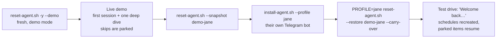

# Onboarding: How Sidekick Gets to Know Someone

Nov 3, 2026 · @Russ Broomell

Onboarding is the product's first impression and its retention engine. The design has three layers. A **short first session** hooks the person. **Deep dives** show how useful it gets with a few more minutes. A **plan file** makes sure nothing skipped is ever lost, including when a demo turns into a test drive on the person's own bot.

## Why not one long interview

The big agents win on day one and lose people in week two. Muse brings back 73% of new users the next day, then drops fast. A 25-minute interview fails both ways: it's a chore on day one, and it front-loads everything instead of giving a reason to come back. So:

- **First session: about 7 minutes.** Enough to meet a character, do something real and see the Life Map. It ends on a hook, not a form.
- **Deep dives: 3–5 minutes each, one area of life at a time.** Each ends with something *running*: a reminder, a watcher, a list, a draft. Ten minutes in, the person has three things working for them, not three pages of answers.
- **Then a drip of one optional item a day** in the morning brief: a parked question, or (twice a week) a deep-dive offer based on what they've mentioned. This gives them a small reason to open the brief and keeps the agent getting better for weeks.

**In a demo, use the first session plus one live deep dive (about 12 minutes).** The first session proves it's fun and does real work. The deep dive proves what "more time" buys: the prospect picks an area of their own life and watches it get set up. That beats a longer interview, because the second half is a *result*, not more questions.

## The first session (about 7 minutes)

| Act | What happens | Why |
| --- | --- | --- |
| 1. Hello (30 s) | Who it is; never spends, sends, books or cancels without OK; data stays on their server. Their name | Trust before anything else |
| 2. Meet me (2 min) | Audition of six personalities (two rounds of buttons), its name, **strength** previewed at 1 against 5, voice line | The fun part, and it makes the agent *theirs* |
| 3. Basics (1 min) | Town, work, quiet hours | Just enough to be useful tomorrow; work answers point to deep dives |
| 4. Tomorrow (1 min) | Brief time; it schedules brief, loops check, recap and distill. Calendar link (live mode) | Guarantees a reason to come back tomorrow |
| 5. First win (2 min) | Three errand offers with buttons; does one live | Value in the first five minutes |
| 6. Life Map (1 min) | Shows all ten areas; offers the three that fit; demo: runs one now | Shows the depth |
| Wrap-up | Readback, what happens next, magic phrases, `/new` | Clear expectations; nothing feels lost |

## Deep dives

Ten modules, each with a pitch, a few questions (buttons where possible), what gets **set up**, and a **proof moment** done on the spot.

| Area | Minutes | Running at the end | Proof moment |
| --- | --- | --- | --- |
| Home & car | 4 | Maintenance calendar; registration, inspection and warranty reminders; recall check | Right filter size, a service interval, or a Saturday pro |
| Money & bills | 5 | Bills and renewals calendar; subscription math; a price watch; monthly money minute | Yearly cost of suspect subscriptions, or the current promo price to ask for |
| Health & appointments | 3 | Checkup cadence; refill reminders | Booking page or number, plus a drafted booking message |
| Family & people | 4 | Birthdays with gift ideas; stay-in-touch nudges | A warm message drafted in their voice |
| Work & inbox | 5 | VIP and noise rules; triage schedule; meeting prep; promise tracking | Triage of a forwarded thread, with a reply drafted |
| Travel | 3 | Trip loops; fare watcher; packing list two days out; flight status | Best fare for an upcoming trip, or a packing list now |
| Food & errands | 3 | Shopping list by text or voice; meal ideas; staples nudges | This week's meals plus a shopping list |
| Goals & habits | 3 | Check-ins and a weekly score | First check-in set for tomorrow |
| Small business | 5 | Lead follow-ups; invoice-chasing drafts | A polite payment reminder or a lead follow-up |
| Faith, community & volunteering | 3 | Duties in the brief; seasonal look-aheads | This week's announcement or a thank-you note |

Modules live in `distribution/skills/deep-dive/modules/`. Each is a short Markdown file, so adding one (for example "Pets", "Kids' school" or "Real estate agent") means copying a module and editing it.

## Skipping, parking and coming back

Anything skipped is **parked**, never lost. `notes/onboarding-plan.md` holds:

- **Mode:** `live`, `demo` or `test-drive`.
- **Life Map:** each area as not started, suggested, in progress (stopped at Qn), done, parked, not now, or not for me.
- **Parked questions:** each with its area, why it helps, and the date.

The person can read and edit it on the Memory Card like any other note. It comes back three ways:

1. **When they ask:** "What else can you do?", "let's continue", or "help me with my car stuff".
2. **In the morning brief:** one optional item a day, in live and test-drive modes only. Two "later"s move an item down the list; three retire it. After three weeks it stops, apart from a monthly mention in the Friday recap.
3. **On a test drive:** the first message to their own bot gets a welcome back with what's set up and what's parked. It recreates the schedules on the new bot and offers to pick up where you left off.

The "About you" questions from the old long interview (weekday rhythm, protected time, what's urgent, off limits, bluntness, public profile, time off) are parked automatically at the end of every first session, so they drip in over the first two weeks.

## Demo → test drive, step by step



1. **Before the demo:**

   ```bash
   bash ~/personal-agent/scripts/reset-agent.sh -y --demo
   ```

   In demo mode it moves fast, skips the calendar question, parks generously, and never nags afterwards.
2. **The demo:** they drive the first session and pick one deep dive. Anything they skip is parked.
3. **Right after:** save what they told it.

   ```bash
   bash ~/personal-agent/scripts/reset-agent.sh --snapshot demo-jane
   ```

4. **When they say yes to a test drive:** create their own bot (a second profile with its own Telegram bot; use different ports from your main agent):

   ```bash
   MC_PORT=8766 WEBAPP_PORT=9121 bash ~/personal-agent/scripts/install-agent.sh --profile jane
   ```

5. **Carry the demo over:** their memory, notes, parked questions, character and strength move across. The demo's chats, schedules and browser logins don't.

   ```bash
   PROFILE=jane bash ~/personal-agent/scripts/reset-agent.sh --restore demo-jane --carry-over
   ```

6. **They message their bot.** It welcomes them back, recreates the brief and other schedules, asks them to send `/sethome` if needed, and offers the parked area first.

For a longer-term customer, move their agent to their own server or PC with `scripts/move-agent.sh`. That's the point of the product.

**On a 4 GB server**, two bots can run side by side, but only one bot's browser screen at a time. For more than one or two test drives, use an 8 GB server or give each person their own.

## Quality bar

Run the onboarding checks in [`tests/persona-check.md`](../tests/persona-check.md) after any change to these skills. A stellar onboarding:

- never asks two questions in one message;
- offers buttons whenever there are choices;
- reaches the first win within about 5 minutes;
- ends every deep dive with something running and one thing done;
- never loses a skipped answer;
- never asks for a password, account or card number;
- makes the person laugh at least once, at their chosen strength.
