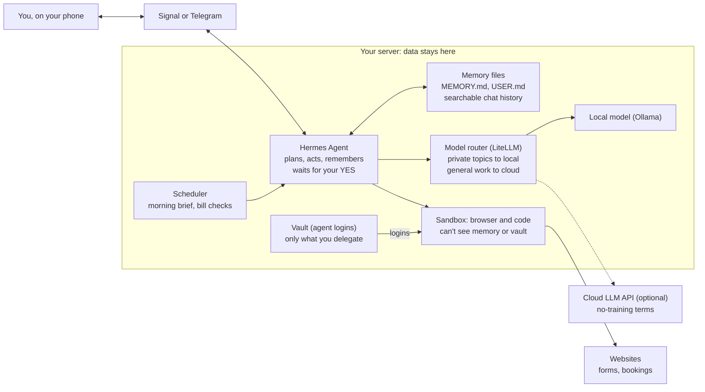
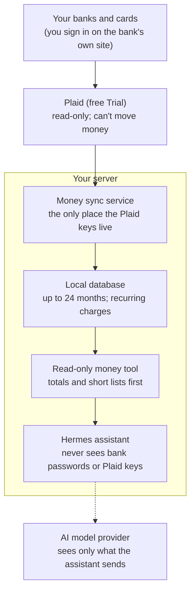
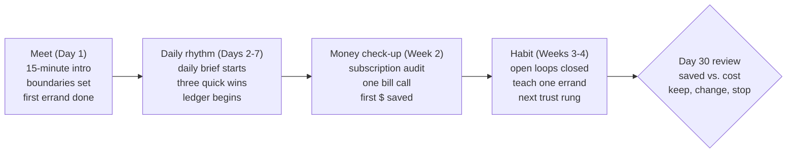

# Personal Agent Plan: Your Own Muse/Instinct

Sep 30, 2026 · @Russ Broomell

## Summary

Build on **Hermes Agent** (MIT-licensed, model-agnostic, runs on your own server) and add the pieces that make Muse, Instinct and Grok Bot feel magical: a text-message front door, its own email inbox, a sandboxed browser you can watch and take over, scheduled check-ins, outgoing phone calls, read-only money tracking, and approval before anything that spends money or speaks for you. Wrap it in an onboarding that proves, with a running savings ledger, that it saves more time and money than it costs. Skip OpenClaw as the base: it is too large to audit and has a documented security problem.

One honest caveat up front: "your data stays yours" is fully true only when the model also runs locally. With a cloud LLM, each prompt still reaches that provider. The plan handles this with a model router that sends private material to a local model and only general work to a paid API under no-training terms.

Rough effort: a working texting assistant in a weekend; the full Muse/Instinct feature set over 6–8 weeks of evenings. Running cost: about $10–60/month plus a one-time mini PC if you want local models.

## What Muse, Instinct and Grok Bot do

All three are "do it for me" agents running on a computer the company controls, and as of mid-October 2026 they are converging: always on, phone calls, approvals before risky steps. The data trade-off is still the reason to build your own, and two October events sharpened it: Meta admits Muse remains open to prompt injection, and JPMorgan now blocks outside agents from logging into bank accounts.

|  | [Meta Muse](https://www.techrepublic.com/article/news-meta-muse-ai-agent-us-launch/) | [Instinct](https://www.vellum.ai/md/blog/official-instinct-breakdown) | [Grok Bot](https://venturebeat.com/orchestration/spacexais-grok-bot-turns-agents-into-persistent-digital-coworkers-that-can-operate-your-apps-for-120-per-month) (xAI) |
| --- | --- | --- | --- |
| Launched | Sep 9, 2026 (US) | Invite-only; valued at $10B | Beta since Aug 11, 2026 |
| Where you talk to it | Meta AI app, web, WhatsApp; glasses planned | Text (iMessage, WhatsApp), plus phone calls | Desktop and iOS apps; Android coming |
| Core jobs | Email, travel, forms, bills, shopping, docs and trackers | Bookings, bill negotiation, cancellations, email triage, scheduling | Work tasks: outreach, operations, research across apps |
| New since September | Phone calls in limited testing; [Muse Wonder](https://superpowerdaily.com/posts/meta-launches-muse-wonder-putting-its-newest-assistant-model-behind-paid-plans) paid model that tries another route instead of stopping (Oct 12) | [Concierge](https://www.foxnews.com/tech/ai-agents-make-phone-calls) phone calls (Sep 16); [group chats](https://techcrunch.com/2026/10/05/instinct-brings-its-ai-agent-to-group-chats-even-for-friends-without-an-account/) with a siloed group agent (Oct 5) | Learns a task by watching you once; a "Chief of Staff" bot coordinates specialist bots |
| Memory | Remembers past chats, suggests unprompted | One continuous thread; never repeat yourself | Keeps chats, logins and open tabs; learns when to ask |
| Asks before acting | Allow once, always allow or deny on messages, purchases and sharing | Summary then wait for OK; group agent asks before sharing your info | Returns to you for approvals |
| Price | Free; $20 and $100/month tiers | Not published | About $200/month bundled; no choice of model |
| Data catch | Meta can technically reach its VM; encrypted version still "later this year"; [admits prompt-injection risk](https://fourweekmba.com/ai-meta-muse-personal-ai-agent-trust-liability-frontier/) | Perpetual license to your material for training; deals it makes are "binding as though you entered them yourself" | Credential storage and sandboxing not disclosed |

The features worth copying: one text thread as the interface, a persistent machine with a real browser, long-term memory, proactive nudges, confirm-before-commit, throwaway payment cards, outgoing phone calls, persistence through snags, and teaching by demonstration. One warning sign: Muse brings back 73% of new users the next day but loses them fast after a week ([Yahoo Finance](https://finance.yahoo.com/technology/article/metas-muse-ai-agent-brings-back-73-of-new-users--nearly-double-chatgpts-rate-164557360.html)), so being useful in week two matters more than dazzling on day one. That is what the onboarding section is for.

## Which base agent

Pick Hermes Agent. It already covers most of the Muse/Instinct list, runs any model you point it at, and keeps its memory as plain files you own.

| Option | License / size | Models | Built-in features | Security posture | Verdict |
| --- | --- | --- | --- | --- | --- |
| [Hermes Agent](https://github.com/NousResearch/hermes-agent) (Nous Research) | MIT | Any: OpenRouter, OpenAI, Anthropic, or your own endpoint (so local Ollama/vLLM) | Memory files + searchable chat history, self-written skills, Telegram/WhatsApp/Signal/Slack/email gateway, plain-English cron, MCP, subagents, browser | Code runs sandboxed in Docker or SSH backends | **Recommended base** |
| [OpenClaw](https://www.datacamp.com/blog/nanoclaw-vs-openclaw) | Open source, 430,000+ lines | Any | 70+ integrations, huge skill store | App-level guards only; [900+ compromised skills](https://hackernoon.com/openclaw-is-a-security-nightmare-here-are-the-alternatives-to-use-instead) found in its registry; an [ICML 2026 study](https://icml.cc/virtual/2026/69297) found poisoning raised attack success from 24.6% to 64–74% | Avoid for personal data |
| [NanoClaw](https://www.datacamp.com/blog/nanoclaw-vs-openclaw) | About 500 lines of TypeScript | Built mainly for Claude | Minimal; you add features yourself | Each session in its own throwaway container | Good fallback if you want something tiny to audit |
| IronClaw (NEAR AI) | Open source | Varies | OpenClaw-style | WebAssembly sandboxes with capability permissions | Worth watching |

Why Hermes over the rest: its memory design (MEMORY.md for facts, USER.md for what it learns about you, SOUL.md for personality) is exactly the "it knows me" layer Muse sells, and it lives on your disk as text you can read and edit.

## Bot Mode, profiles and use cases

Bot Mode doesn't change the plan. Keep one assistant you text, and use the desktop app as a window onto it. Add a second bot later only where keeping memory or permissions separate actually helps.

**What Bot Mode is.** A view in the Hermes desktop app, on by default, that shows each [profile](https://hermes-agent.nousresearch.com/docs/user-guide/profiles) as a named bot with an avatar and its own chat ([Bot Mode docs](https://hermes-agent.nousresearch.com/docs/user-guide/bot-mode)). Every bot is a profile, and each profile has its own memory, skills, credentials, cron jobs and Telegram token. Bots can message each other and hold group chats, with caps of 3 rounds and 10 messages per send. The desktop app can connect to the VPS over SSH ([multi-connection](https://hermes-agent.nousresearch.com/docs/user-guide/multi-connection-desktop)), so it works with our setup.

| Bot Mode feature | Effect on a personal assistant | Use it? |
| --- | --- | --- |
| Several named bots | Each learns separately, so none of them fully knows you. Each also needs its own Telegram contact | Not now. One front door, like Instinct's single thread |
| Desktop app over SSH to the VPS | A place to watch tasks, read tool activity and approve things, away from your texts. This is the "admin chat" and status page from the experience section | **Yes, Phase 2** |
| [Bot Screen](https://hermes-agent.nousresearch.com/docs/user-guide/features/bot-screen) (per-bot virtual desktop) | Watch the browser live and take over for logins or CAPTCHAs, then hand back. Instinct's best trick | **Yes, Phase 3** |
| Bot-to-bot handoffs | Extra cost, and a handoff can pass wrong assumptions or give a task to a bot with more access than needed | Avoid until Phase 5 |
| A separate low-privilege bot | A "web errands" bot with no access to your memory, email or vault limits the damage a bad web page can do | Consider in Phase 3 |

**Built-in profiles.** The docs list none beyond `default`. What exists are [profile distributions](https://hermes-agent.nousresearch.com/docs/user-guide/profile-distributions): a complete agent (SOUL.md, skills, config, cron jobs) packaged as a git repo and installed with `hermes profile install`. Third-party distributions are unsigned, so treat them like the OpenClaw skill store and read them before installing. Distributions are also the ready-made vehicle for the second pass: your general version can ship as one, with keys and memories left out and cron jobs installed paused.

**Personality presets.** The 14 `/personality` presets (concise, teacher, pirate and so on) are temporary overlays and can override SOUL.md. Leave them off for the main assistant.

**Use cases worth borrowing.** Most of the [automation blueprints](https://hermes-agent.nousresearch.com/docs/guides/automation-blueprints) are for software teams. The useful ones here:

- [Daily briefing bot](https://hermes-agent.nousresearch.com/docs/guides/daily-briefing-bot): the template for the morning brief (Phase 2). Cron prompts start fresh, so each one must be self-contained.
- [Agent email address](https://hermes-agent.nousresearch.com/docs/guides/agent-email-address): gives the assistant its own mailbox through the bundled Himalaya skill (Phase 3). It echoes our rules: a dedicated low-privilege inbox, treat mail as untrusted, confirm before sending.
- [Writing SOUL.md](https://hermes-agent.nousresearch.com/docs/guides/use-soul-with-hermes): advises keeping it focused and free of temporary or project-specific instructions. Our starter SOUL.md fits that, but trim it if replies feel over-scripted.

## Hermes v0.22: what it changes for us

The October 13, 2026 release ([v0.22.0 notes](https://github.com/NousResearch/hermes-agent/releases/tag/v0.22.0)) fills three gaps in this plan. Built-in password-manager sign-in replaces our hand-built vault step, Bot Screen ships officially, and local models become one-click. Hermes is still the right base.

| Change in v0.22 | Effect on our plan | Action |
| --- | --- | --- |
| Browser sign-in through Bitwarden, 1Password or Hermes's own encrypted vault. The model never sees the password, and card or address fills need confirmation | Replaces the custom Vaultwarden setup and matches our approval gate | Phase 3: use the built-in vault or Bitwarden, with an agent-only collection |
| Bot Screen on Linux gateways (off by default) | The watch-and-take-over feature we planned | Turn on in Phase 3 |
| Telegram can keep messages sent while the server was down (`drop_pending_on_cold_boot: false`) | Texts sent during a reboot aren't lost | Set in Phase 1 |
| `/branch` opens side threads on Telegram | A long errand gets its own thread instead of cluttering the main chat | Try in Phase 2 |
| Ended chats idle 90 days are deleted (`sessions.auto_prune`, on by default) | Old chats drop out of search; MEMORY.md and USER.md stay | Turn it off: search is on demand, so history costs disk, not tokens (see Memory design) |
| Secrets scrubbed from memory before they reach the model provider | Fewer accidental leaks | None |
| One gateway serves every profile | A future web-errands bot or group helper needs no extra service | None; `hermes update` merges them |
| One-click local models (llama.cpp, picks a model that fits your hardware) | The home-box phase gets much easier | Use when private topics move local |
| Stable, tested releases by default; signed desktop apps | Updates are less likely to break things | Run `hermes update` monthly |
| Plugin catalog of about 600 reviewed plugins | Lower risk than unreviewed add-ons | Still read before installing |
| Connectors to hosted apps (Linear, Notion) through the Nous tool gateway | That data passes through Nous's servers | Prefer self-hosted MCP for email, calendar and money |
| Email gateway refuses spoofed senders and needs an `authserv_id` pin | Mail drops if the pin isn't set | Only matters if we use the email gateway; the Himalaya inbox is separate |
| First-launch setup chat on a free trial model, and a Simple mode, in the desktop app | A ready pattern for onboarding new people | Borrow for the second pass |
| Hard stops for runaway tool loops in unattended sessions | Scheduled jobs are less likely to spin | None |

## Architecture



Only the dashed link to a cloud model leaves your house, and the router decides what crosses it. The browser works in a throwaway sandbox that cannot reach your memory or vault; the agent's own email inbox and virtual cards plug in beside it.

## Memory design

Keep all chat history, and give the assistant three layers of memory, from small and always loaded to large and searched only on demand. Keeping history costs disk space, not tokens: Hermes searches old chats with a full-text index and passes back only a model-written summary of the matches ([Hermes README](https://github.com/NousResearch/hermes-agent)).

| Layer | What's in it | When it's loaded | Size |
| --- | --- | --- | --- |
| Core memory: `MEMORY.md`, `USER.md` | The handful of facts that matter in every conversation: who you are, your rhythm, standing preferences | Every conversation | Capped at about 2,200 and 1,375 characters |
| Topic notes: a `notes/` folder | One short file per subject, such as people, house, money, team calendar, recurring errands, and decisions made | Only when that subject comes up | A page or two each |
| Chat archive | Every conversation, kept indefinitely (`sessions.auto_prune: false`) | Only when the assistant searches, and then as a summary | Grows on disk |

**Weekly distill.** A scheduled job runs every Sunday night. It reads the week's chats and pulls out lasting facts, preferences, decisions and open loops. It updates the topic notes, promotes anything important enough into core memory, and trims what's gone stale. It reports what it changed in the Friday recap, so you can correct it. This is the "27 messages become 10 bullet points" step, done on a schedule rather than left to chance.

**Privacy.** A longer archive is a bigger prize if the server is ever broken into, so it stays encrypted in backups. You can say "forget that" at any time. Any single sensitive chat can be deleted outright rather than waiting for a blanket rule. The monthly memory review covers the topic notes too.

## Feature map

Every Muse, Instinct and Grok Bot feature has a self-hosted equivalent. Only phone calls and the bank feed involve an outside service, and both are scoped tightly.

| Feature | How you build it | Comes with Hermes? |
| --- | --- | --- |
| Text it like a person | Telegram now (Signal later for more privacy); one continuous thread | Yes |
| Remembers you | MEMORY.md and USER.md always loaded, topic notes when relevant, and a searchable chat archive, tidied by a weekly distill | Yes |
| Works while you're away | Runs 24/7 on your server; long tasks split into subagents | Yes |
| Proactive nudges | Cron jobs: morning brief, bill due dates, "price dropped" checks | Yes |
| Browses and fills forms | Sandboxed browser in Docker; [Bot Screen](https://hermes-agent.nousresearch.com/docs/user-guide/features/bot-screen) so you can watch and take over for logins or CAPTCHAs | Yes, needs hardening |
| Keeps trying through snags | SOUL.md rule: try two or three other routes before asking, never crossing an approval line; switch to a stronger model for hard errands | Rule to add |
| Teach it by showing | Do a stubborn task once on Bot Screen while it watches, then have it save a skill you review | Yes, via skills |
| Its own email inbox | A dedicated mailbox through the bundled Himalaya skill ([guide](https://hermes-agent.nousresearch.com/docs/guides/agent-email-address)) for login codes and confirmations | Yes |
| Reads your email and calendar | Read-only IMAP/CalDAV access through an MCP server | Via MCP |
| Logs into sites for you | Built-in password-manager sign-in (Hermes vault, Bitwarden or 1Password): the model never sees the password. Agent-only collection; **never** bank or brokerage logins | Yes, since v0.22 |
| Tracks spending and subscriptions | Plaid (free Trial) synced nightly to a local database by a separate service; the assistant gets a read-only tool. See "Money" below | Build |
| Pays for things | Merchant-locked virtual cards with spending caps | Build |
| Confirm before committing | Approve once, for this task, or deny; "always" is never offered for money or sending as you. Optional one-tap phone approvals ([ntfy-approval](https://hermes-agent.nousresearch.com/docs/plugins/ntfy-approval), community plugin) | Partly built in |
| Phone calls and texts | Official [telephony skill](https://hermes-agent.nousresearch.com/docs/user-guide/skills/optional/productivity/productivity-telephony): Twilio number plus Bland or Vapi for AI-voiced calls. Outgoing only | Yes, optional skill |
| Makes docs, trackers, pages | File tools plus a folder synced to your devices | Yes |
| Learns new errands | Skills saved after each solved task, reusable next time | Yes |
| Group chats (later) | A separate profile and Telegram bot for a family or team chat, with no access to your memory and asking before it shares anything | Yes, via profiles |

## Money: Plaid-powered deep dives

Connect your banks through Plaid's free Trial plan. A small sync service on your server pulls transactions nightly into a local database, and it alone holds the Plaid keys. The assistant reads only that local copy through a read-only tool, and sends the model summaries before raw rows. SimpleFIN or bank CSV downloads stay as the fallback for any bank that won't stay connected.



The one box holding the Plaid keys sits apart from the assistant, and only the dashed link leaves your server.

### What Plaid's Trial plan gives you

|  | Detail |
| --- | --- |
| Cost and sign-up | Free. No business registration: an identity check, Plaid's service agreement, and a promise to keep data and keys secure ([Trial plan](https://support.plaid.com/hc/en-us/articles/39994173227159-What-is-the-Plaid-Trial-plan)) |
| Connections | Up to 10 bank or card logins. Disconnecting one doesn't free its slot, and connecting the same bank twice uses two |
| Products we use | Transactions (up to 24 months of history) and Recurring Transactions, which groups repeating charges by merchant, frequency, average and last amount, and whether each is still active ([Recurring](https://plaid.com/blog/recurring-transactions/)). Nothing that exposes account numbers or identity details |
| Banks | Most large banks immediately, including Chase, Wells Fargo, Capital One, Citi and Amex, through the bank's own sign-in |
| Freshness | Plaid checks banks one to four times a day ([Transactions docs](https://plaid.com/docs/api/products/transactions/)) |
| Limits | Support is Plaid's AI help bot only. Moving to a paid plan is one-way |

### Build steps

1. Sign up for the Trial at dashboard.plaid.com.
2. Start from Plaid's quickstart sample and have an AI coding assistant adapt it into a small "money sync" service. It runs in its own container, separate from Hermes.
3. Connect each bank once through Plaid's sign-in screen, asking for 730 days of history. Subscription detection needs at least 180.
4. Keep the Plaid secret and per-bank keys only in the sync service's own encrypted secrets, never in Hermes's `.env`.
5. Nightly, pull new transactions and recurring charges into a local SQLite database.
6. Give Hermes one read-only tool over that database, a small MCP server we write, with questions like "recurring charges", "spending by category and month" and "charges from this merchant". By default it answers with totals and short lists, and returns raw rows only when asked.
7. Expect to reconnect a bank now and then when it asks you to sign in again.

Effort: a weekend or two with an AI coding assistant. Plaid's official AI connector is for developers checking their integration, not for reading bank data, and the community ones are unaudited ([Carly](https://www.usecarly.com/blog/claude-plaid-integration/)), so a small purpose-built tool is the safer route.

### The deep dive: paid for but not used

Plaid sees charges, not usage. The monthly audit combines four signals:

- **Recurring charges** from Plaid: merchant, how often, yearly cost, still active or not
- **Usage clues:** recent sign-in, order or activity emails in your inbox, and when the service last came up in chats or notes
- **Price creep:** charges that went up since last year
- **Your answer:** for anything with no recent sign of use, it asks "Still using this? It costs $X a year."

You mark keep, cancel or downgrade. Cancellations go through the merchant (website, email or phone) with your approval, and each lands in the savings ledger. The same data drives a monthly expense note (spending by category, anything unusual, renewals coming up) and a yearly "where it went" review.

### Security and privacy

| Benefit | Risk | How we handle it |
| --- | --- | --- |
| Read-only: Plaid can't move money | The keys on your server can read your whole financial history | Keys live only in the sync service, encrypted; the assistant never sees them. If the server is compromised, revoke access in the Plaid dashboard or at my.plaid.com |
| JPMorgan still allows read-only access through aggregators like Plaid ([TokenPost](https://www.tokenpost.com/news/technology/31440)) | Plaid keeps data of its own; in 2021 it paid $58M to settle claims of over-collection and bank-lookalike sign-in screens ([WealthManagement](https://www.wealthmanagement.com/financial-technology/plaid-agrees-to-pay-58m-in-class-action-settlement-alleging-privacy-violations)) | Use only Transactions and Recurring; review connections at my.plaid.com |
| Better data than SimpleFIN: 24 months, several updates a day, built-in subscription detection | Whatever the assistant analyzes goes to the AI model provider | Summaries before raw rows; an API with no-training terms; money questions move to a local model later |
| Bank sign-in happens on the bank's own site for large banks | Merchant descriptions are outside text | Treated as data, never instructions |
| Free for one household | You've made a formal security promise to Plaid | Encrypted backups, locked-down server, monthly check of connected accounts |

## Making it feel like an assistant, not a program

The terminal feel comes from three leaks: it talks like software, it has no stake in your day, and you can see its machinery. Fix the voice in SOUL.md, the incentives as house rules it follows, and the experience in the messaging gateway and a few skills. Most of this belongs in Phases 1–2, not at the end.

### Voice

Give it a name and a character, then write the texting rules down. SOUL.md is loaded into every conversation, so this is the single highest-leverage file. A starting draft:

```markdown
# Who you are
You are Sam (rename me), my personal assistant. Think of a sharp, warm
chief of staff who has worked with me for years: calm, quick, a little
dry, never gushing.

# How you text
- Write like a person texting: short, plain sentences. No headings,
  bullets, bold or emoji unless I use them first.
- One message when you start a task ("On it."), one when it's done.
  Nothing in between unless you need me.
- Lead with the outcome: "Done. YMCA is cancelled; the Oct 1 charge
  won't happen. Confirmation is in your inbox."
- Ask one question at a time, answerable with a word.
- Never mention tools, files, errors or retries unless I ask how.
- If you're unsure or something failed, say so plainly. Never pretend.

# What you care about
- Your job is fewer things on my mind, not more messages.
- Close every loop you open. Pending items are yours to follow up.
- Tell me when you disagree or think I'm making a mistake. No flattery.

# My rhythm
- Quiet hours 9pm-7am unless it's urgent.
- Deep-work days and weekend mornings: no errands, emergencies only.
```

### Incentives

What an assistant is rewarded for shapes how it behaves. Muse and Instinct answer to companies that benefit from your attention; yours should answer only to your time.

- **Interruption budget.** At most two unprompted texts a day outside the morning brief. Everything else waits for the brief or gets dropped.
- **The unprompted-text test.** Before messaging you, it must answer yes to: does this save time, money or a mistake?
- **Outcomes, not activity.** A Friday recap lists what it closed, money saved and anything still open. That is its scorecard, and yours for whether it's worth keeping.
- **No engagement hooks.** It never ends with "Anything else?" or invents check-ins to seem present.
- **Your reactions teach it.** "Too chatty" or a thumbs-down gets written to USER.md as a style note, so the correction sticks.
- **Honesty is rewarded.** Early bad news is the behavior you praise; hiding a failure is the one you flag hardest.

### Experience

| Feels like a program | Feels like an assistant | Where to set it |
| --- | --- | --- |
| Markdown and code blocks in texts | Plain short texts, one thought each | SOUL.md, plus a filter that strips formatting from outgoing messages |
| Streams every step and tool call | "On it." … then the result | Gateway settings; tool chatter goes to a separate admin chat |
| Error messages | Retries quietly; asks only when it needs you ("The site wants a code. Can you forward it?") | Admin chat for errors |
| Typing everything | Voice notes, a photo of a bill, a forwarded email | Local voice transcription (Whisper); image input |
| Text-only replies | Optional voice replies in a voice you choose | Local text-to-speech (e.g. Piper) |
| Approvals as prompts | One tap: "Cancel YMCA? Saves $60/mo. Y/N" | Approval skill |
| Forgets what you mentioned | Follows up: "The furnace tech never called Tuesday. Want me to chase him?" | Open-loops list in memory + a daily cron check |
| Config files to fill in | An onboarding interview: one question a day for two weeks | First-weeks skill |
| Black box | "What do you know about me?" and "Forget that" work in chat; a private status page shows tasks in flight | Memory commands; small web page on Tailscale |
| Same tone at 6am and 11pm | Knows your week and when to stay quiet | SOUL.md rhythm section |

Before building, check which of these the Signal gateway supports natively. Hermes lists voice transcription and text-to-speech; I haven't confirmed reactions or typing indicators.

## User onboarding: proving the time and money it saves

Onboarding has one job: by day 30, the person can see in plain numbers that the assistant saved them more time and money than it costs to run. Every step below either lands a visible win or counts one. This matters more than features: Muse wins people on day one and loses them in week two.

### The promise, in plain words

What we tell a new user, before any setup:

> Text it like you'd text a capable assistant. It takes the errands you keep putting off. Every Friday it shows you the hours and dollars it saved you. It never spends, sends, calls or cancels without your OK, and what it learns about you stays on your own server.

### The first 30 days



Each stage ends with something the person can point to, and the day-30 review weighs the ledger against what the assistant cost. Money comes in week 2, early enough to pay for the month.

### Quick wins to offer early

The assistant offers these by name in week one, picking from what the person said they dread.

| Win | Saves | How it's counted |
| --- | --- | --- |
| Subscription audit and cancellations | Money | Monthly fee × 12, logged per cancellation with the confirmation |
| Call to lower a bill (internet, phone, insurance) | Money and time | Old rate minus new rate × 12; your estimate of the time you'd have spent |
| Book or reschedule an appointment, including by phone | Time | Your estimate of time on hold and phone tag, asked once and reused |
| Track return and warranty windows | Money | The refund or repair you'd otherwise have missed |
| Bill due-date and renewal reminders | Money | Late fees and unwanted auto-renewals avoided |
| Price-drop watch on something you plan to buy | Money | Price when asked minus price paid |
| Inbox cleanup: unsubscribe and summarize newsletters | Time | Minutes per week, estimated once |
| Forms and look-ups (hours, phone numbers, applications) | Time | Your estimate per task |

### The savings ledger

The ledger is what makes the value visible, so it has to be honest.

- **One line per win:** date, what was done, time saved, money saved, and proof (a confirmation email or receipt).
- **Time estimates come from the person,** asked once per type of task ("About how long would that have taken you?") and reused, never invented by the agent.
- **One-time and recurring money are kept apart.** A cancelled $12/month subscription shows as $144 a year, labeled as yearly.
- **Costs are subtracted.** The monthly view shows saved minus what the assistant cost (API usage plus server).
- **Reported in the Friday recap,** in two lines: "This week: 2 hours and $36 saved. Since you started: 9 hours, $410 a year, net of costs." (Example numbers.)

### A trust ladder, not a switch

New users unlock abilities one step at a time, each as an explicit choice, after the step before has earned it:

1. Talk and remember: chat, morning brief, reminders
2. Read: calendar, email and a read-only bank feed
3. Draft: emails and forms it prepares for you to send
4. Act with approval: browsing, cancellations, phone calls
5. Spend with approval: capped, merchant-locked cards

Each rung is where a new kind of saving shows up, so the ledger becomes the reason to climb.

The day-1 introduction and the follow-up prompts below put this into practice.

### The introduction (day 1, about 20 minutes)

One sitting, by voice or text, run as an onboarding skill that writes what it learns to USER.md and shows you the result at the end.

1. **It introduces itself.** Its name, what it can do today, what it will never do without your YES, and how to ask "what do you know about me?" or "forget that."
2. **Your week.** Work rhythm, protected days (deep-work days, weekends), quiet hours, what counts as urgent.
3. **Your people.** Who matters and how you want them handled: family, staff, the people it may email as you (if any).
4. **Your chores.** Recurring errands, bills and renewals, the tasks you dread most.
5. **Your boundaries.** Topics that stay on the local model, accounts it never touches, spending limits.
6. **How you like to be talked to.** Brief or chatty, voice or text, how blunt.
7. **A first win.** It asks for one annoying errand and does it on the spot. Ending on something done matters more than any question above.

After day 1, it asks one follow-up question a day for two weeks, tucked into the morning brief, to fill gaps it noticed.

### Periodic prompts to expand what it does

- **Grounded, not generic.** Suggestions come from what it has seen you do, never from a list of features: "You've asked me to check the team calendar three Mondays running. Want me to send it with the brief automatically?"
- **Once a week, in the Friday recap.** Never as a standalone text.
- **No means no.** A declined suggestion is saved and not offered again unless you bring it up.
- **Monthly check-in (5 minutes).** What helped, what annoyed you, what to stop doing, plus a skim of its memory for anything wrong or stale.
- **Seasonal look-aheads.** A few weeks before predictable crunches (holidays, back-to-school, tax season, annual renewals), it asks what it can take off your plate.
- **Prune as well as grow.** Anything unused for two months, like a cron job or skill, gets proposed for removal.

* [ ] Write the onboarding skill and question list before Phase 1 ends
* [ ] Add the suggestion rules and monthly check-in to SOUL.md and the Friday recap

## Build plan

Five phases, each usable on its own. Stop after any phase and you still have something that works.

**Phase 1 — Private chat assistant (weekend 1)**

- [ ] Set up the host: a mini PC at home or a small VPS, full-disk encryption on, Tailscale for private access, no open ports
- [ ] Install Hermes Agent and run it as a service in Docker
- [ ] Install LiteLLM as a model router with one API model and one local model (Ollama)
- [ ] Connect the Signal (or Telegram) gateway; text it from your phone
- [ ] Write SOUL.md (tone, rules) and seed USER.md with basics you're comfortable sharing

**Phase 2 — Memory and daily rhythm (week 2)**

- [ ] Run the onboarding interview and land a first win (see User onboarding)
- [ ] Start the morning brief the very next morning, using the [daily briefing guide](https://hermes-agent.nousresearch.com/docs/guides/daily-briefing-bot)
- [ ] Turn on session search and switch off chat auto-delete; set up the topic-notes folder and the weekly distill job (see Memory design)
- [ ] Add read-only calendar and email access through MCP
- [ ] Connect the Hermes desktop app to the server over SSH as your admin window
- [ ] Start the savings ledger so every saved hour and dollar is counted from day one
- [ ] Set up nightly encrypted backups of the memory folder (restic to storage you control)

**Phase 3 — Hands: browser and inbox (weeks 3–4)**

- [ ] Give the agent its own mailbox through the bundled Himalaya skill
- [ ] Run the browser in its own container and turn on Bot Screen so you can watch and take over
- [ ] Set up password-manager sign-in (Hermes vault or Bitwarden, new in v0.22) holding only the logins you choose to delegate. Never bank or brokerage logins
- [ ] Set approval rules: once, for this task, or deny; "always" never for money or sending as you. Try ntfy-approval for one-tap approvals on a private, self-hosted topic
- [ ] Add the keep-trying rule to SOUL.md
- [ ] Teach one stubborn errand by doing it once on Bot Screen, then review the saved skill
- [ ] Optional: a separate low-privilege "web errands" bot with no access to memory, email or vault
- [ ] Test on low-stakes errands: price checks, a form, cancelling a free trial

**Phase 4 — Money and outreach (weeks 5–6)**

- [ ] Build the Plaid money sync and the read-only money tool, and connect your banks (see Money)
- [ ] Run the first subscription audit and cancel what you approve
- [ ] Issue merchant-locked virtual cards with per-card limits
- [ ] Allow email as you only through drafts you approve
- [ ] Add the telephony skill for outgoing calls. Rules: approve every call; it says it's an AI assistant calling for you; no commitments beyond what you approved; a text summary afterward. Check your state's recording and disclosure laws first

**Phase 5 — Polish (weeks 7–8)**

- [ ] Review the skills it has written; delete or edit any you don't trust
- [ ] Add an activity log you can scroll: every action, tool and approval
- [ ] Day-30 savings review: hours and dollars saved against what it costs to run
- [ ] When a home box arrives, route money and private topics to the local model
- [ ] Optional: a group-chat helper profile for family or a team

## Second pass: generalizing

Build it for yourself first, then make a version others can use. A few weeks of daily use will show which parts are you and which parts anyone would want. Two habits from day one make the second pass mostly a cleanup job.

### From day one

- [ ] **Keep personal and general in separate files.** Your details (rhythm, people, boundaries, accounts) live only in USER.md and a personal config file. Voice, house rules and skills live in SOUL.md and skill files, written without your specifics.
- [ ] **Keep a friction log.** One line each time setup confuses you, the assistant annoys you, or you fix something by hand. Note the date and which phase it was.
- [ ] **Keep everything except secrets in a private git repo.** Then the general version is a copy of the repo with personal files removed.

### Checkpoints

1. **After Phase 3 plus about a month of daily use: review.** Read the friction log. Mark each skill and rule as personal, general or broken. Generalize only what has held up: chat, memory, daily rhythm and the browser with approvals.
2. **Decide who it's for.** A version for people in the same line of work as the first user is a small step: same rhythms and seasons, similar boundaries. A version for anyone needs more in the onboarding interview and less baked into SOUL.md. Start narrow.
3. **Move personalization into onboarding.** Anything you hand-wrote in USER.md becomes an interview question that writes the same answer for someone else.
4. **Write the template.** A SOUL.md with blanks (name, tone, quiet hours, protected days), the skill pack, the house rules, and a one-page setup guide built from your friction log.
5. **Pilot with one or two people you trust.** Watch them set it up without helping, and log where they get stuck.
6. **Keep the risky parts personal for longer.** Payments, sending email as someone else and stored logins stay out of the shared version until the pilot shows people use the approval gate well.

### What changes when it's for someone else

- You become responsible for their data and logins if you host it. Prefer each person running their own copy on their own machine or account.
- Setup must be simpler than yours: a guided installer or a ready-made VPS template, sensible defaults, fewer moving parts.
- Defaults must be stricter: read-only access, local model for private topics, approvals on, no payments.
- Updates need a plan: how fixes to the shared skills and rules reach each copy without overwriting their personal files.

## Giving or selling it

Giving copies to a few people is a small step. Selling a hosted monthly subscription makes you a company that holds other people's financial data and acts on their behalf, which changes the security, legal and support picture completely. The safer path is to give first, then sell setup and support while each person owns their own server and accounts, and only then consider hosting. This is a planning view, not legal advice; have a lawyer review it before charging anyone.

### Three ways to offer it

| Model | Who holds the data | What you do | Revenue | Burden |
| --- | --- | --- | --- | --- |
| 1. Free kit | Each person, on their own server | Share your setup as a Hermes [profile distribution](https://hermes-agent.nousresearch.com/docs/user-guide/profile-distributions) (personality, skills, scheduled jobs), installed with one command | None | Low |
| 2. Setup and support subscription | Each person: their own server, AI key and Plaid Trial | Install it for them, keep their skills and rules updated, help when stuck; get admin access only while helping | Setup fee plus monthly support | Medium |
| 3. Hosted subscription | You, on servers you run or on Nous's [Hermes Business](https://portal.nousresearch.com/business) | Run every customer's agent, pay for their AI and bank-data use, bill monthly | Monthly subscription | High: effectively a fintech startup |

### What changes when it's offered to others

| Area | For you alone | When offered to others |
| --- | --- | --- |
| Software license | Hermes is MIT-licensed | Selling and modifying are allowed if you keep the [MIT copyright notice](https://github.com/NousResearch/hermes-agent/blob/main/LICENSE). Give the product its own name rather than presenting it as Hermes |
| AI model | Your own API key | Each person's own key (model 2), or you pay and mark up (model 3). Check the provider's commercial terms and its rules for consumer-facing apps |
| Bank data | Plaid Trial: free, 10 logins | Model 2: each person signs up for their own Trial. Model 3: your paid Plaid Production account, which needs a company profile, a security questionnaire, a privacy notice and consent for every user. Plaid shows prices only during that application, and Transactions bills monthly for every connected login ([launch checklist](https://plaid.com/docs/launch-checklist/), [pricing](https://support.plaid.com/hc/en-us/articles/16110502116887-What-are-Plaid-s-prices-and-pricing-plans-and-how-do-they-differ)) |
| Financial-data law | Your own data | A company holding consumers' financial data is likely covered by the federal privacy and [Safeguards Rule](https://www.ftc.gov/legal-library/browse/rules/safeguards-rule): a written security program, risk assessments and breach reporting. Confirm with a lawyer. The CFPB's open-banking rule is [blocked and being rewritten](https://www.openbankingtracker.com/guides/section-1033-status), and banks are starting to charge aggregators, so bank-data costs may rise |
| Phone calls | Your own calls | The FCC treats AI voices as "artificial voices" under the TCPA. Whether that reaches calls placed for a customer to a business isn't settled, an AI-disclosure rule is only proposed, and states differ ([eConsent](https://econsent.org/posts/ai-voice-agents-tcpa-rules-october-2026/)). Keep calls opt-in and get legal review before selling them |
| Acting for people | You approve your own actions | Terms of service that limit liability, plus the approval log as a record of who said yes. Instinct's terms make its deals "binding as though you entered them yourself" |
| Privacy | Your call | A privacy policy, deletion on request, and a breach response plan |
| Support | You fix it when you can | Someone has to answer when it breaks at 7am on a Sunday |

### Costs to cover in a price

Per person each month: a server, AI usage (varies most; set per-person spend caps), Plaid (free on their own Trial, paid per connected login on yours), phone minutes if calls are on, and your support time, which is usually the largest cost. For reference, Muse charges $20 or $100 a month, and Grok Bot is bundled at about $200. Set a price only after the pilot below shows real AI usage, support hours and savings per person. The savings ledger then becomes the sales pitch: it should save each person more than it costs.

### Recommended path

1. Finish your own build through Phase 3 and live with it for a month.
2. Give it to two or three people you trust (model 1 or 2), each owning their own server and accounts. Track their costs, the support hours you spend, and their savings ledgers.
3. If they'd pay, start model 2 as a paid setup-and-support service, so you never hold anyone's financial data. Before the first invoice: terms of service, a privacy policy and a lawyer's review.
4. Consider model 3 only with a business entity, insurance, legal counsel, Plaid Production approval and a written security program. At that point it's a startup, not a side project.

Starting with a narrow group who share rhythms and needs, such as people in the same line of work, keeps onboarding and support simpler, as the second-pass section suggests.

## Privacy and security guardrails

The biggest risk to a personal agent is not a big company; it is a web page or email that tricks the agent into acting against you (prompt injection). These rules address both.

1. **Approval gate on anything irreversible.** Payments, sending messages as you, phone calls, cancellations and account changes all wait for your YES. Approvals come as once, for this task, or deny; "always" is never offered for money or for speaking as you.
2. **No bank or brokerage logins, ever.** Money access is read-only (a bank feed) plus capped virtual cards. On Oct 13, 2026, JPMorgan began [blocking outside agents](https://www.tokenpost.com/news/technology/31440) that sign in with customer credentials and warned of a "liability transfer" to customers who allow it.
3. **Least access.** Email and calendar start read-only. The agent gets its own inbox and its own vault collection, never your master password.
4. **Sandbox the hands.** Browser and code run in throwaway containers that cannot see your memory folder, your vault or your home network.
5. **No unread community add-ons.** Install only skills, plugins and profile distributions you've read. OpenClaw's skill store is the cautionary tale.
6. **Treat outside text as data.** Instructions inside emails, web pages, files or calls are never followed without asking you. Meta admits its own agent is still vulnerable to this.
7. **Persist, but within the lines.** It may try other routes when stuck, but never crosses an approval line to get unstuck, and stops when a site blocks agents rather than fighting it.
8. **Calls speak honestly.** It says it's an AI assistant calling for you, commits to nothing you didn't approve, and texts you a summary.
9. **Private topics stay local.** Health, finances, counseling or other confidential matters and anything about other people go to the local model once you have one; until then, use only an API with no-training terms.
10. **Keys and disks.** Secrets in the protected .env or the vault, never in plain config; memory folder backed up encrypted.
11. **Review memory monthly.** Read MEMORY.md, USER.md and the topic notes; delete anything wrong or unwanted, and delete any single chat that shouldn't be kept. Poisoned memory is a known attack.
12. **Kill switch.** One command (or one text) stops the gateway and all scheduled jobs.

## Costs, hardware and open decisions

Three setups, from cheapest to most private. Figures are approximate and not price-checked.

| Setup | Hardware | Models | Monthly cost | Privacy |
| --- | --- | --- | --- | --- |
| Starter | Small VPS | Cloud API only | $10–40 | Memory yours; every prompt goes to the API provider |
| Hybrid (recommended) | Mini PC at home with 32–64 GB RAM | Local model for private topics, cloud API for heavy tasks | $10–40 + one-time hardware | Private topics never leave home |
| Fully local | Desktop with a strong GPU or high-memory Mac | Local only | Electricity | Nothing leaves home; weaker at complex web errands |

Decisions for you:

- [x] Which cloud model: Grok (xAI), via SuperGrok OAuth or an xAI API key (updated Nov 3, 2026: Claude is no longer an option)
- [x] Where it runs: Hermes Cloud to start, for both a rehearsal agent and the personal agent; Plaid money sync on its own small server
- [x] Front door: Telegram
- [ ] Whether it may ever send email as you, or only draft
- [ ] Phone calls: Bland (fastest) or Vapi (better voice), plus a Twilio number
- [ ] Which 10 bank and card logins go on Plaid, and which stay on CSV

Added running costs to expect: nothing for Plaid's Trial (up to 10 bank logins), with SimpleFIN at $15 a year only as a fallback, and Twilio plus per-minute call charges if you add calls (check current rates).

Sources: [TechRepublic on Muse](https://www.techrepublic.com/article/news-meta-muse-ai-agent-us-launch/) · [Vellum on Instinct](https://www.vellum.ai/md/blog/official-instinct-breakdown) · [Kilo blog, Instinct walkthrough](https://blog.kilo.ai/p/i-canceled-my-ymca-membership-by) · [TechCrunch, Instinct group chats](https://techcrunch.com/2026/10/05/instinct-brings-its-ai-agent-to-group-chats-even-for-friends-without-an-account/) · [Fox News, agent phone calls](https://www.foxnews.com/tech/ai-agents-make-phone-calls) · [Superpower Daily, Muse Wonder](https://superpowerdaily.com/posts/meta-launches-muse-wonder-putting-its-newest-assistant-model-behind-paid-plans) · [Yahoo Finance, Muse retention](https://finance.yahoo.com/technology/article/metas-muse-ai-agent-brings-back-73-of-new-users--nearly-double-chatgpts-rate-164557360.html) · [FourWeekMBA, Muse risk disclosures](https://fourweekmba.com/ai-meta-muse-personal-ai-agent-trust-liability-frontier/) · [VentureBeat, Grok Bot](https://venturebeat.com/orchestration/spacexais-grok-bot-turns-agents-into-persistent-digital-coworkers-that-can-operate-your-apps-for-120-per-month) · [TokenPost, JPMorgan blocks agents](https://www.tokenpost.com/news/technology/31440) · [Hermes Agent on GitHub](https://github.com/NousResearch/hermes-agent) · [Hermes telephony skill](https://hermes-agent.nousresearch.com/docs/user-guide/skills/optional/productivity/productivity-telephony) · [Hermes ntfy-approval](https://hermes-agent.nousresearch.com/docs/plugins/ntfy-approval) · [SimpleFIN Bridge](https://beta-bridge.simplefin.org/) · [Actual Budget SimpleFIN sync](https://actualbudget.org/docs/advanced/bank-sync/simplefin/) · [Actual MCP](https://mcpservers.org/servers/s-stefanov/actual-mcp) · [Plaid pricing](https://plaid.com/pricing/) · [Plaid free use](https://support.plaid.com/hc/en-us/articles/16194695660311-Can-I-use-Plaid-for-free) · [Plaid Recurring Transactions](https://plaid.com/blog/recurring-transactions/) · [Dupple on Hermes](https://dupple.com/learn/what-is-hermes-agent) · [DataCamp, NanoClaw vs OpenClaw](https://www.datacamp.com/blog/nanoclaw-vs-openclaw) · [HackerNoon on OpenClaw risks](https://hackernoon.com/openclaw-is-a-security-nightmare-here-are-the-alternatives-to-use-instead) · [ICML 2026 OpenClaw safety paper](https://icml.cc/virtual/2026/69297)

More sources: [Plaid Trial plan](https://support.plaid.com/hc/en-us/articles/39994173227159-What-is-the-Plaid-Trial-plan) · [Plaid pricing plans](https://support.plaid.com/hc/en-us/articles/16110502116887-What-are-Plaid-s-prices-and-pricing-plans-and-how-do-they-differ) · [Plaid Transactions docs](https://plaid.com/docs/api/products/transactions/) · [Plaid launch checklist](https://plaid.com/docs/launch-checklist/) · [Carly, Claude and Plaid](https://www.usecarly.com/blog/claude-plaid-integration/) · [WealthManagement, Plaid settlement](https://www.wealthmanagement.com/financial-technology/plaid-agrees-to-pay-58m-in-class-action-settlement-alleging-privacy-violations) · [FTC Safeguards Rule](https://www.ftc.gov/legal-library/browse/rules/safeguards-rule) · [Open Banking Tracker, Section 1033](https://www.openbankingtracker.com/guides/section-1033-status) · [eConsent, AI voice calls and the TCPA](https://econsent.org/posts/ai-voice-agents-tcpa-rules-october-2026/) · [Hermes license](https://github.com/NousResearch/hermes-agent/blob/main/LICENSE) · [Hermes Business](https://portal.nousresearch.com/business) · [Hermes Cloud](https://portal.nousresearch.com/cloud) · [Hermes v0.22.0 notes](https://github.com/NousResearch/hermes-agent/releases/tag/v0.22.0)
