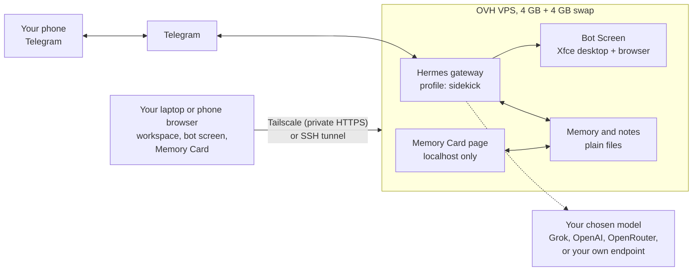

# Setup Guide: Sidekick on a 4 GB OVH VPS

Nov 3, 2026

By the end you'll text your own assistant on Telegram. It runs 24/7 on your OVH server with its own browser that you can watch and take over, and the AI model is your choice. Its memory is plain files you can read and edit on a private Memory Card page.

Plan on about an hour, mostly waiting for installs. Everything runs on your server; your computer only needs a terminal and a web browser.

> **Working name.** "Sidekick" is a placeholder until we pick a product name. Changing it later is a find-and-replace.

## What you'll end up with



Only SSH is open to the public internet. The workspace and Memory Card listen on the server's localhost. You reach them from your own devices over Tailscale (no SSH; works on a phone) or through an SSH tunnel.

## Before you start (10 minutes)

- [ ] **Server details** from the OVH control panel: the VPS's **IPv4 address** and the **default user name**. That's `ubuntu` on Ubuntu images and `debian` on Debian images.
- [ ] **Check the OS.** Log in (Step 1) and run `cat /etc/os-release`. **Ubuntu 24.04** or **Debian 12/13** are supported. Anything else? Reinstall from the OVH panel (VPS → *Reinstall*). If you're reinstalling anyway, **Debian 13** is the smoothest for the bot's browser.
- [ ] **An SSH key on your computer.** If you don't have one, run `ssh-keygen -t ed25519` in Terminal (Mac) or PowerShell (Windows). If your VPS was set up with a password, copy your key over once:

  ```bash
  ssh-copy-id ubuntu@YOUR_SERVER_IP
  ```

  On Windows, which has no `ssh-copy-id`: log in with the password, then paste the contents of your `.pub` file into `~/.ssh/authorized_keys` on the server.
- [ ] **Telegram** on your phone.
- [ ] **A free [Tailscale](https://tailscale.com) account**, with the Tailscale app on your laptop and phone, signed in. This lets you see the bot's browser without SSH (Step 6).
- [ ] **A Grok account** (the default model). A **SuperGrok or X Premium+** subscription signs in with OAuth, no key needed. If xAI answers `403` after login, your tier isn't allowed on the API. Then create an API key at console.x.ai and set a spend limit. Other options are in [docs/models.md](models.md).

## Step 1: Log in

```bash
ssh ubuntu@YOUR_SERVER_IP
```

Use `debian@` on a Debian image. Type `yes` the first time. Your prompt changes to the server's name.

## Step 2: Get the repo onto the server

```bash
sudo apt-get update && sudo apt-get install -y git
git clone https://github.com/russbroomell/personal-agent.git ~/personal-agent
```

It's worth skimming `scripts/bootstrap-vps.sh` before running it with sudo: it's about 150 commented lines.

## Step 3: Prepare the server (about 10 minutes)

```bash
sudo bash ~/personal-agent/scripts/bootstrap-vps.sh
```

It does the following:

- updates packages and turns on automatic security updates
- adds **4 GB of swap**
- creates the **`agent`** user with your SSH key (it asks you to set a sudo password)
- gives that user its own copy of the repo
- sets the firewall to **SSH only**
- installs the bot's desktop (TigerVNC + Xfce) and a browser for it: Chromium on Debian, Google Chrome on Ubuntu, because Ubuntu's own Chromium is a snap that doesn't run well here

When it finishes, it prints the next steps.

## Step 4: Switch to the agent user, then lock SSH down

Open a **new** terminal on your computer, keeping the first one open, and check that the new login works:

```bash
ssh agent@YOUR_SERVER_IP
```

If that works, go back to the first window and turn off root and password logins:

```bash
sudo bash ~/personal-agent/scripts/bootstrap-vps.sh --harden-ssh
```

From now on, always log in as `agent`.

## Step 5: Install the agent (about 15 minutes)

As `agent`:

```bash
bash ~/personal-agent/scripts/install-agent.sh --persona pip
```

Swap `pip` for `sam`, `mortimer`, `rex`, `nova` or `vic` to start with a different personality, and add `--strength 1` to `5` for how strong it is (default 3). The person also picks both in their first chat, and can switch any time later. Add `--name "Ziggy"` to rename it.

The script:

1. Installs Hermes with the official installer (sudo may ask for your password once, for a library Node.js needs).
2. Installs the **sidekick** profile from `distribution/`: skills, house rules, safety settings. Then it builds the personality (`SOUL.md`), the notes folder and a starter core memory.
3. Points the bot's screen at the browser from Step 3 and starts the **Memory Card** service.
4. **Asks to set up the model.** Say yes. Pick a provider in the menu:

   | You have | Pick in the menu | What happens |
   | --- | --- | --- |
   | SuperGrok / X Premium+ | **xAI Grok OAuth (SuperGrok / Premium+)** | It prints a link and a code. Open the link anywhere, enter the code, approve. No tunnel needed |
   | xAI API key | **xAI** | Paste the key |
   | Anything else | See [models.md](models.md) | |

   Pick `grok-4.6` (the top of the list) as the default.
5. **Asks about Telegram.** Two routes; use either:
   - **Text wizard (now):** say yes. Create a bot with [@BotFather](https://t.me/BotFather) (`/newbot`), paste its token, and get your numeric user ID from [@userinfobot](https://t.me/userinfobot).
   - **QR (later, easier):** say no. After Step 6, open the workspace → **Messaging → Telegram → Create with QR** and scan it with your phone.
6. Installs and starts the **gateway** as a service, so it runs 24/7 and comes back after a reboot.

It finishes by printing your tunnel command and Memory Card link. Copy both somewhere handy.

**Want a second model ready,** so you can switch live in the demo? Add another provider, for example OpenRouter or Nous Portal:

```bash
hermes -p sidekick model
```

Pick the second provider in the menu, then switch any time from Telegram with `/model`. Your Grok sign-in stays.

## Step 6: See the workspace and the bot's browser

Pick one route. **Tailscale is the one to use for the demo:** no terminal on your laptop, and it works on a phone.

### Route A: Tailscale (no SSH, works on your phone)

Tailscale puts the server on a private network that only your own devices can join. It gives the workspace an HTTPS address like `https://sidekick-vps.tail1234.ts.net`, which nobody else can reach. On the server, as `agent`:

```bash
bash ~/personal-agent/scripts/remote-access.sh
```

It:

1. Installs Tailscale and prints a login link. Open it and approve the server on your Tailscale account.
2. Allows traffic that arrives over Tailscale in the firewall (the public internet still only reaches SSH).
3. Serves the workspace at `https://<name>.ts.net` and the Memory Card at `https://<name>.ts.net:8443`. **If Tailscale says HTTPS certificates aren't enabled,** open the link it prints, click **Enable**, and run the script again.
4. Asks you to choose a **workspace password** (12+ characters). Your username is `agent`.
5. Restarts the gateway and prints both addresses.

Then, on your laptop or phone (Tailscale app on and signed in), open the workspace address and sign in. Open the Memory Card link once; your browser remembers it.

**For the demo:** this means no terminal on your laptop, just a browser tab. You can even hand your phone to the prospect with the bot's screen on it. To let a prospect's own device in after the demo, Tailscale can **share** this one machine with their Tailscale account (admin console → Machines → Share). They still need the workspace password.

### Route B: SSH tunnel (no extra account)

On **your computer**, in a terminal you leave open:

```bash
ssh -N -L 9120:127.0.0.1:9120 -L 8765:127.0.0.1:8765 agent@YOUR_SERVER_IP
```

This works the same in Mac Terminal and Windows PowerShell. It looks like it hangs; that's correct. Then **on the server**:

```bash
hermes -p default webapp --no-open
```

Open the one-use link it prints in your laptop's browser, within 60 seconds. (Once Route A is set up, the workspace asks for the password here too.)

**Memory Card:** open the `http://127.0.0.1:8765/?token=…` link the installer printed. Lost the link? Run:

```bash
python3 ~/personal-agent/scripts/memory-card/server.py --home ~/.hermes/profiles/sidekick --print-url
```

### What's in the workspace

It's Hermes Desktop in a browser: chats, Messaging, scheduled jobs and the **bot's Screen**.

## Step 6½: Turn on voice (2 minutes)

```bash
bash ~/personal-agent/scripts/voice-setup.sh grok
```

Use `free` instead of `grok` if your xAI plan doesn't include voice. Then send `/voice on` to the bot once. Now you can send voice notes on Telegram, or press the voice conversation button in the workspace (Tailscale address) and talk to it. Details: [voice.md](voice.md).

## Step 7: Say hi

1. In Telegram, open your bot, tap **Start**, and send **`/sethome`**. This tells scheduled messages (the morning brief, recaps) where to go.
2. Say hi. The **5-minute first session** starts: names, the personality audition (buttons), how strong (a hint, balanced or full character), three questions, the morning brief time, then a first errand done live.
3. Afterwards, check the workspace's **scheduled jobs** list: you should see the Morning brief, Open loops check, Friday recap and Weekly distill.

If the first session didn't create them, run this on the server with your time zone and brief time:

```bash
bash ~/personal-agent/scripts/schedule-jobs.sh "America/New_York" "07:00"
```

## Step 7½: Make the bot look good (3 minutes)

First impressions count, especially if you'll show it to friends. In Telegram, message [@BotFather](https://t.me/BotFather):

- `/setuserpic`: a picture for the character you picked (an emoji on a coloured square works fine).
- `/setdescription` (shown before someone taps Start): *Your own AI sidekick. Six personalities, talks back, remembers what matters, and never spends a cent without asking. Runs on its owner's server. Say hi.*
- `/setabouttext` (shown on the bot's profile): *Personal assistant with a personality. Open source: github.com/russbroomell/personal-agent*
- `/setinline`: turn on inline mode, so typing `@yourbot` in any chat searches its commands.

## Step 8: Test the browser hand-off

From Telegram:

> Find the opening hours of the public library nearest to me and send me a screenshot.

In the workspace, open **Bots → sidekick → Screen**, or the Screen box in the sidebar. You'll see the desktop and the browser working. Click **Take over**: the border turns red and your mouse and keyboard now drive the bot's screen. Click **Hand back** to return control.

For the real thing, ask for something that needs a login. The bot stops at the login page, sends you a screenshot, and asks you to take over. Sign in, hand back, and say "done".

> **The first screen start takes 10–20 seconds** on a 4 GB server. Open the Screen once before a demo so it's warm. It switches itself off after 20 idle minutes to free memory.

## Step 9: Pre-demo checklist

Run through [`tests/persona-check.md`](../tests/persona-check.md) (about 15 minutes) and [`demo/demo-script.md`](../demo/demo-script.md).

At minimum, the night before:

- [ ] `hermes -p sidekick doctor` shows no errors
- [ ] `free -h` shows swap on
- [ ] The bot answers on Telegram; `/model` lists the providers you signed in to
- [ ] The workspace loads at your Tailscale address (laptop **and** phone) and the Screen starts
- [ ] The Memory Card loads and an edit saves
- [ ] Your phone is on Do Not Disturb, except Telegram

## Living with it

| Task | Command (on the server, as `agent`) |
| --- | --- |
| Update everything (repo, Hermes, skills; keeps memory) | `bash ~/personal-agent/scripts/update.sh` |
| Change personality or name | `bash ~/personal-agent/scripts/set-persona.sh rex "Coach"` (or just ask the bot) |
| **Reset to brand new** (erase memory, notes, chats, schedules; keep sign-ins) | `bash ~/personal-agent/scripts/reset-agent.sh` |
| Save / restore a demo state | `bash ~/personal-agent/scripts/reset-agent.sh --snapshot lived-in`, then `--restore lived-in` |
| Back up (memory, notes, chats, keys) | `bash ~/personal-agent/scripts/backup.sh` |
| Stop the agent completely | `hermes -p sidekick gateway stop` (or text it "stop everything") |
| Move to another machine | `bash ~/personal-agent/scripts/move-agent.sh export`, then `import` there |
| Logs | `hermes -p sidekick logs --follow` |

## Memory on a 4 GB server

From Hermes's own measurements: the gateway idles at about 300 MB, and the bot's desktop adds about 220 MB. **A browser on the screen adds 0.5–1 GB.** Plan on roughly 1.5 GB in use while the bot browses, against 4 GB of RAM plus 4 GB of swap. That's comfortable for one person.

Hermes refuses to start a screen when less than 1 GB is free; our config lowers its 1.5 GB default to fit a 4 GB box. If you see that refusal, close the browser on the screen or wait for it to stop on its own. If you add a second bot, or want several browser tabs at once, move to 8 GB.

## Security notes

- **Only SSH is open to the public internet.** The workspace (port 9120) and Memory Card (8765) listen on localhost only. They're reachable through Tailscale, from devices on your Tailscale account and behind a password, or through an SSH tunnel.
- **Don't make it public.** Tailscale's *Funnel* feature or a router port-forward would put the workspace on the open internet. Hermes's password login is meant for private networks only. If you ever need a public address, use Hermes's Nous account sign-in (see the Hermes web dashboard docs), not the password.
- **Treat the workspace like a shell on the server.** Anyone signed in can run commands as `agent`. Don't share the password, and sign out on shared computers (`hermes -p default webapp --sign-out` signs out every browser).
- **The bot's screen is a workspace, not a safe.** What you sign in to on it stays signed in for the bot. Never sign in to banking or brokerage there. The house rules forbid it, and so should you.
- **Commands run directly on the server as `agent`,** not in a Docker sandbox. On a 4 GB box we trade the sandbox for memory, and every risky command still needs your approval. On 8 GB+, set `terminal.backend: docker` with `terminal.docker_image: nousresearch/hermes-sandbox:desktop` to put the shell, browser and screen inside a container.
- **OVH can technically reach the disk.** That's still far better than a big company holding your memory, and the move script takes everything to a machine at home whenever you like.

## If something goes wrong

Start with `hermes -p sidekick doctor` and include its output when asking for help.

| What you see | Likely cause | Try |
| --- | --- | --- |
| `Permission denied (publickey)` for `agent` | Your key wasn't copied | Log in as `ubuntu`/`debian`, then run `sudo cat /home/agent/.ssh/authorized_keys`. Add your `.pub` key if it's missing |
| `hermes: command not found` | New PATH not loaded yet | `export PATH="$HOME/.local/bin:$PATH"`, or log out and in |
| Bot never replies | Gateway not running, or Telegram token or ID wrong | `hermes gateway list` should show `sidekick` served; `journalctl --user -u hermes-gateway -n 50` shows errors |
| Morning brief never arrives | No home channel | Send `/sethome` to the bot; check `hermes -p sidekick cron list` |
| Grok login works but replies fail with 403 | xAI hasn't enabled OAuth API access for your tier | Use an xAI API key (`hermes -p sidekick model` → xAI) |
| Screen says packages missing | Bootstrap step skipped or failed | `hermes -p sidekick computer-use screen status` prints the exact install line; run it with `sudo` |
| Screen refuses to start (memory) | Less than 1 GB free | `free -h`; close the bot's browser; check that swap is on |
| Browser on the screen won't start, `No usable sandbox` | Ubuntu's user-namespace restriction | Make sure `browser.executable_path` is `/usr/bin/google-chrome-stable`: `hermes -p sidekick config set browser.executable_path /usr/bin/google-chrome-stable` |
| Workspace link says it's expired | Links are single-use, valid 60 seconds | Run `hermes -p default webapp --no-open` again |
| Workspace won't load | Tunnel not running, or webapp off | Re-run the tunnel command, then `hermes -p default webapp --status` |
| "The Webapp is off" | `webapp.enabled` isn't true on the **default** profile (the gateway ignores it on `sidekick`) | Re-run `remote-access.sh`, or `hermes -p default config set webapp.enabled true` then `hermes -p default gateway restart` |
| Workspace build stops partway ("Killed", exit 137) | Out of memory: the build needs more than 4 GB of RAM alone, and some VPS images ship with little or no swap | `sudo bash ~/personal-agent/scripts/bootstrap-vps.sh` tops swap up to 4 GB; then re-run `remote-access.sh`, which stops the bot's screen before building |
| "The Webapp is not built" | The workspace app hasn't been built yet | `hermes -p default webapp --build-only` (a few minutes); no restart needed |
| `{"detail":"Invalid Host header…"}` | The workspace wasn't told its Tailscale name on the **default** profile, or the gateway hasn't restarted since | Re-run `remote-access.sh`: it sets `webapp.public_url` to your exact `https://…ts.net` name, restarts, and checks the address answers |
| Tailscale address doesn't load | Your device isn't on Tailscale, or HTTPS isn't enabled for your tailnet | Open the Tailscale app and check it's connected to the same account; on the server, `tailscale serve status`; re-run `remote-access.sh` |
| Tailscale address loads but the screen viewer won't open | Opened over plain `http://` | Use the `https://…ts.net` address. Browsers block the screen viewer without HTTPS |
| Workspace password rejected | Wrong password, or too many tries (10 a minute) | Wait a minute; to reset, run `RESET_PASSWORD=1 bash ~/personal-agent/scripts/remote-access.sh` |
| `gateway restart` hangs | Usually an old sidekick-only gateway service fighting the main one | Ctrl+C. Run `systemctl --user list-units 'hermes-gateway*'`; if `hermes-gateway-sidekick` is listed, `hermes -p sidekick gateway uninstall`, then `hermes -p default gateway restart` |
| Personality didn't change | Telegram chats are one long session | Send `/new` |

Sources: [Hermes installation](https://hermes-agent.nousresearch.com/docs/getting-started/installation) · [Bot Screen](https://hermes-agent.nousresearch.com/docs/user-guide/features/bot-screen) · [Desktop workspace in a browser](https://hermes-agent.nousresearch.com/docs/user-guide/desktop) · [Providers](https://hermes-agent.nousresearch.com/docs/integrations/providers) · [xAI Grok OAuth](https://hermes-agent.nousresearch.com/docs/guides/xai-grok-oauth) · [OAuth over SSH](https://hermes-agent.nousresearch.com/docs/guides/oauth-over-ssh) · [Profile distributions](https://hermes-agent.nousresearch.com/docs/user-guide/profile-distributions) · [Telegram](https://hermes-agent.nousresearch.com/docs/user-guide/messaging/telegram) · [Cron](https://hermes-agent.nousresearch.com/docs/user-guide/features/cron)
